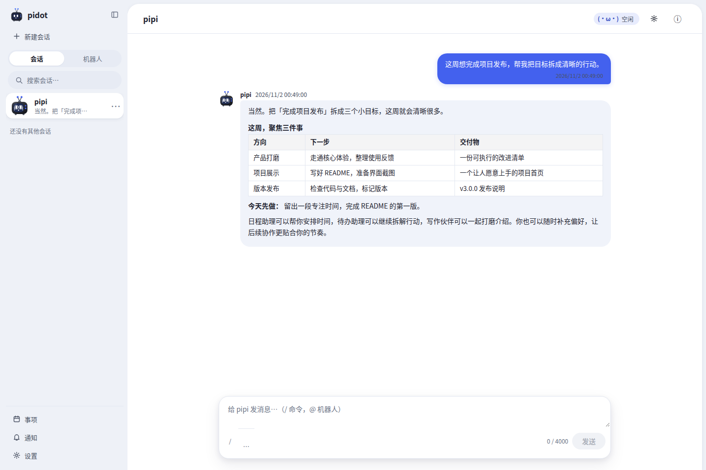
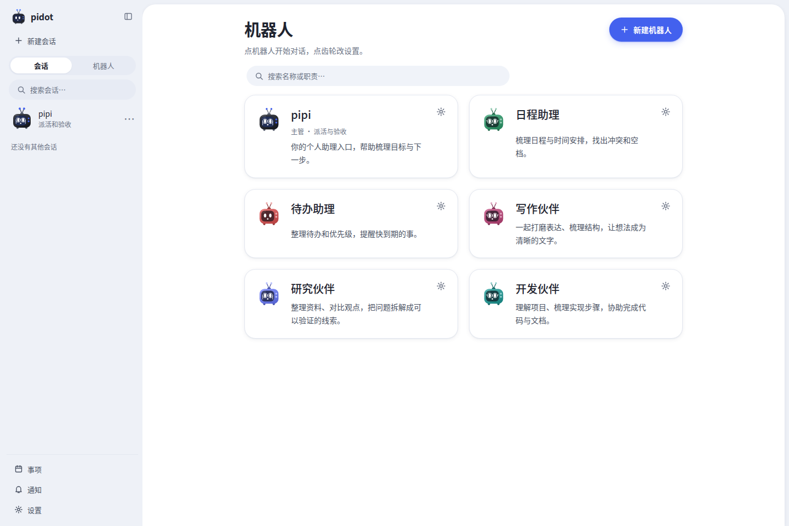
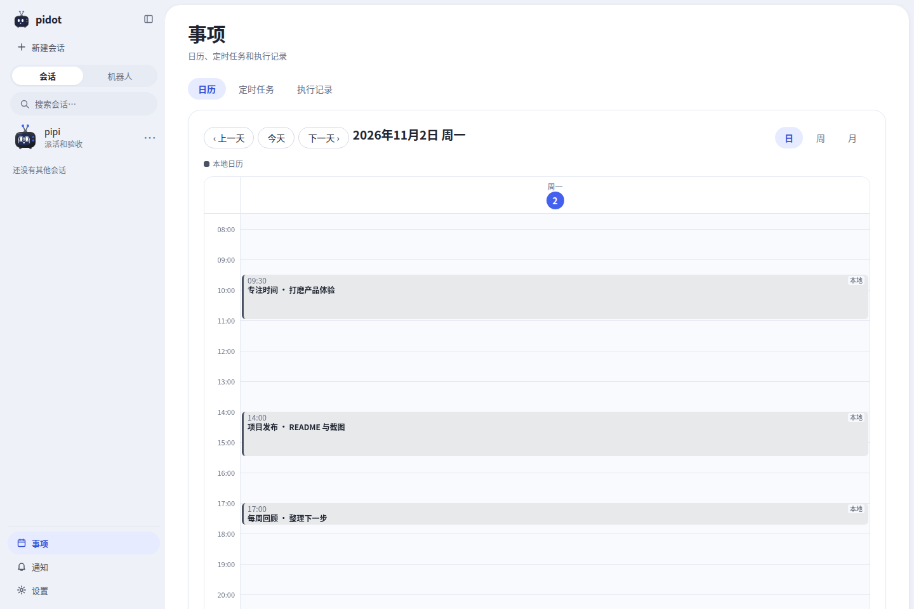
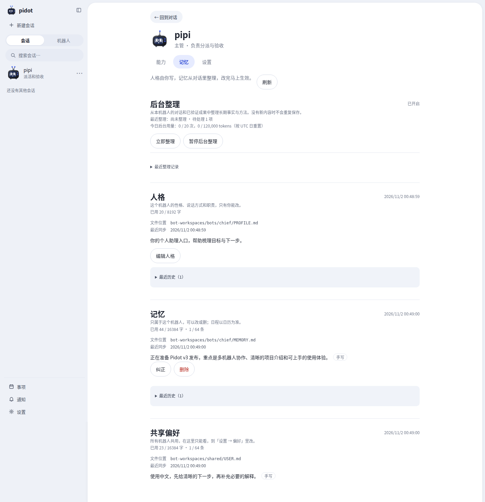
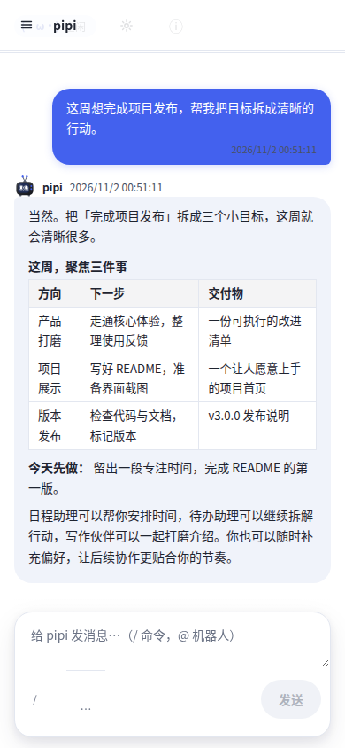

<div align="center">

# Pidot · v3

### 把想法变成行动，让协作持续积累。

一个运行在本机的多机器人个人助理工作台。<br>
从一句想法开始，让不同的机器人协作，把对话、日程、任务和记忆连接起来。

[](https://github.com/zhper-liang/pi-dots/releases/tag/v3.0.0)
[](LICENSE)
[](my-app/README.md)
[](my-app/package.json)

[快速开始](#快速开始) · [界面预览](#界面预览) · [v3 更新](#v3-带来了什么) · [版本说明](docs/releases/v3.0.0.md) · [项目文档](docs/README.md)

</div>



## 让你的个人 AI 团队，各有所长

Pidot 希望让个人助理成为能一起推进事情的伙伴：讨论目标、安排时间、分配工作，再把值得保留的偏好与经验积累下来。

你可以直接和主管机器人 **pipi** 对话，也可以找日程助理、待办助理，或创建自己的写作、研究和开发伙伴。每个机器人都有独立会话、人格、记忆和模型选择；需要协作时，可以委派任务、回交结果，也可以在群聊中通过 `@` 定向沟通。

网页把这些能力放在一起：左侧切换会话与机器人，在「事项」里看日历和定时任务，在「通知」里处理提问、确认和提醒。用一个清晰的工作台，连接日常工作中的不同环节。

## v3 带来了什么

| 亮点 | 你可以怎么用 |
| --- | --- |
| **自己的机器人团队** | 只填名字即可创建机器人，按需设置职责、模型和能力；日常对话与独立任务各有空间。 |
| **从委派到结果回交** | 让主管协调任务、验收成果、提出返工；在群聊中定向派活，保留必要的上下文与结果来源。 |
| **可以持续积累的记忆** | 为每个机器人维护人格和记忆，所有机器人共享用户偏好；支持历史搜索、后台整理和将验证过的方法沉淀为 Skill。 |
| **适合自己的模型组合** | 登记多个 OpenAI 兼容供应商与模型，为不同机器人选择模型、思考深度和上下文容量。 |
| **按需扩展能力** | 通过 Skills、MCP、工具集开关配置能力；每个机器人自带文件读写、编辑和命令执行能力。 |
| **日程与行动放在一起** | 使用日 / 周 / 月日历、定时任务和执行记录，结合本地事项及外部日历连接安排工作。 |
| **更顺畅的对话体验** | Markdown 回复、折叠工具调用、会话列表、问题表单，以及对话中实时生效的能力调整。 |
| **本地运行，数据可掌握** | 一个 Node.js 后端、一个 SQLite 数据库和一个网页；人格、记忆及共享偏好也可通过本地 Markdown 文件编辑。 |

### 例如，你可以这样开始

> 这周想完成项目发布，帮我把目标拆成清晰的行动。

> 看看今天的日程，找一段适合专注工作的空档。

> 创建一个写作伙伴，负责和我一起打磨文章结构。

> 以后请先给下一步，再补充必要的解释。

涉及日程、外部服务或协作时，需要先配置相应连接与能力。模型负责理解和选择工具，实际执行结果可以在会话和记录中查看。

## 界面预览

以下图片均为 **v3 实际网页截图**，使用隔离的演示数据与示例回复，展示产品界面，不包含个人数据或真实账号凭证。

### 一个入口，连接你的机器人团队

按名字和职责找到机器人，直接进入对话，或打开设置调整能力、记忆和模型。



### 把时间安排看清楚

在日历中查看安排，通过「定时任务」管理计划，通过「执行记录」了解运行结果。



### 让每次协作留下积累

人格、长期记忆、共享偏好和后台整理状态集中在机器人记忆页，也支持直接维护本地 Markdown 文件。



<details>
<summary>查看窄屏界面</summary>

网页支持窄屏布局；当前交付形式是浏览器应用。



</details>

## 快速开始

准备 **Node.js ≥ 22.22.1** 和 **pnpm 11.21.0**。

### 1. 获取并安装

```sh
git clone https://github.com/zhper-liang/pi-dots.git
cd pi-dots
git checkout v3.0.0
cd my-app
pnpm install --frozen-lockfile
```

### 2. 配置本地访问

```sh
cp .env.example .env  # 仅首次；已有 .env 时请保留
node -e "console.log(require('node:crypto').randomBytes(32).toString('hex'))"
```

将生成的随机值填入 `my-app/.env` 的 `PIDOT_API_TOKEN=`。这是连接本地网页的口令，请使用与模型 API key 不同的值。

### 3. 启动工作台

```sh
pnpm build
pnpm start:api
```

打开 **[http://127.0.0.1:3001](http://127.0.0.1:3001)**，输入本地访问 token。

首次使用，在「设置 → 模型」配置默认模型连接；也可以「添加模型」登记多个供应商，再到机器人设置中选择。接口需要兼容 OpenAI，模型名与上下文容量按供应商实际支持填写。

也支持在服务端 `.env` 中配置 `OPENAI_BASE_URL`、`OPENAI_API_KEY`、`MODEL`；配置优先级及更多选项见[工程 README](my-app/README.md)。没有模型配置时可以先浏览测试模式界面，配置完成后新会话可使用真实模型。显式设置 `PIDOT_REPLY_MODE=test` 时会禁用真实模型调用和模型设置保存。

### 升级已有版本

先停止旧服务，备份整个数据目录，再更新、构建并启动。默认目录是 `my-app/data/`，备份需包含数据库、记忆文件、Skills 和连接配置。部分旧数据会在首次启动时自动迁移，详细步骤见[升级说明](docs/engineering/operations.md#第四轮升级r4)。

## 连接与运行方式

| 连接 | 当前能力 |
| --- | --- |
| 本地工作区 | 日程与待办读写、日历展示、定时任务、执行记录和应用内通知。 |
| 飞书日历 | 显式绑定应用日历，查询与普通日程读写；真实账号写入仍需用户验收。 |
| Google Workspace | Calendar / Tasks 原生接入；Gmail / Drive / Docs / Sheets 经 workspace-mcp。实现与隔离测试已完成，真实账号验收待完成。 |
| 外部 MCP | 连接 Streamable HTTP 服务或本机已安装的 stdio 程序，按机器人启用工具。 |
| 模型供应商 | OpenAI 兼容接口、多供应商与多模型登记；模型可用性取决于实际供应商。 |

Pidot 面向 **本地单用户**，服务仅监听 `127.0.0.1`。任务和记忆保存在本机，使用远程模型或外部连接时，相关请求会发送到所配置的服务。

已启用的能力可以执行操作；结构化删除操作逐次确认。命令执行使用后端进程的系统权限，**不提供文件系统沙箱，也不按命令内容识别删除行为**，请按需配置和使用。本地 token、模型 key 与连接凭证只在服务端配置或专用表单中输入，勿写入聊天、截图或前端代码。

定时任务需要后端进程在线，浏览器可以关闭；通知当前保存在应用内。后台记忆整理与 Skill 学习已实现，真实模型下的长期学习质量仍待评估。**长任务持续执行已完成规划，尚未实现**；完整状态见 [NEXT_STAGE](NEXT_STAGE.md)，能力边界见 [MVP 范围](docs/product/mvp-scope.md)。

## 开发与文档

技术栈：**React 19 · TypeScript · Vite · Node.js ESM · SQLite · pi-durable · MCP**。

在 `my-app/` 下运行：

```sh
pnpm dev:api  # 本地 API
pnpm dev      # 前端开发服务，另开终端运行
pnpm test     # 自动测试
pnpm lint     # 静态检查
pnpm build    # 类型检查与构建
```

v3 发布检查：**1651 项测试通过**；静态检查完成（10 条既有 warning）；类型检查与隔离构建通过。验证使用隔离数据，外部账号的验证状态见上表。

| 入口 | 内容 |
| --- | --- |
| [工程 README](my-app/README.md) | 安装、模型配置、启动、开发与 API 使用。 |
| [项目文档](docs/README.md) | 产品设计、架构、接口和技术决策。 |
| [架构总览](docs/architecture/README.md) | Agent 运行时、工作区、能力、记忆与连接。 |
| [运行手册](docs/engineering/operations.md) | 外部连接、备份、升级与故障恢复。 |
| [实施计划](plans/README.md) | 已完成记录、当前工作与后续提案。 |
| [当前状态](NEXT_STAGE.md) | 实现进度、验收情况与交付边界。 |

## 一起把个人助理做得更好

欢迎通过 [Issues](https://github.com/zhper-liang/pi-dots/issues) 分享使用场景、反馈问题和提出想法，也欢迎提交改进。希望 Pidot 能成为一个容易理解、方便扩展、能陪你持续做事的个人 AI 工作台。

项目采用 [MIT License](LICENSE)。
