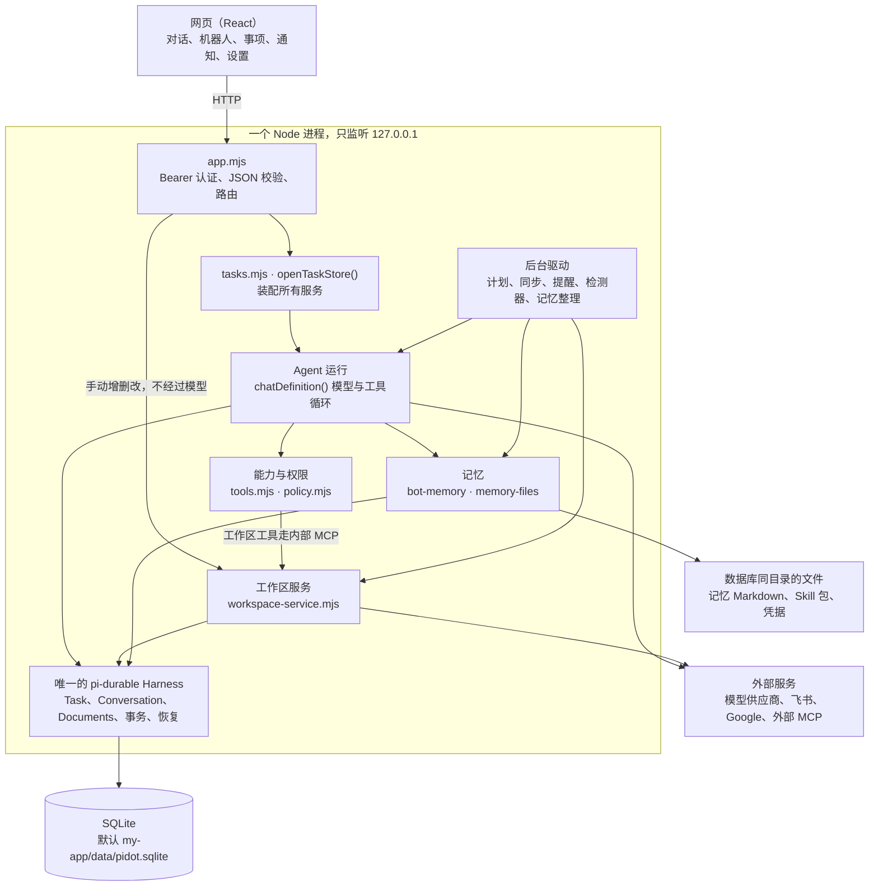

# 架构总览

Pidot 是一个本机运行的多机器人助理：一个网页、一个 Node 进程、一个 SQLite 文件。本文讲整体怎么拼起来；每个子系统的规则在下表对应的文档里，各只写一处。名词（机器人、Task、事项等）的定义见[产品定义](../product/system-design.md#领域语言)。

| 子系统 | 文档 | 回答什么 |
|---|---|---|
| Agent 运行 | [agent-runtime.md](agent-runtime.md) | 一条消息怎么变成模型调用和工具调用；排队、插入、压缩、额度、协作、恢复 |
| 能力与权限 | [capabilities.md](capabilities.md) | 机器人能用哪些工具；什么时候直接做、什么时候确认、什么时候跳过 |
| 记忆 | [memory.md](memory.md) | 人格、记忆、共享偏好存在哪；怎么改、怎么自动整理、怎么学成 Skill |
| 工作区 | [workspace.md](workspace.md) | 日程、待办、计划、提醒、检测器；写操作的一致性 |
| 外部连接 | [integrations.md](integrations.md) | 模型供应商、飞书、Google、外部 MCP、对外 stdio 桥 |

为什么这样选、代价是什么，见[技术决策](../decisions/README.md)。接口字段见 [HTTP](../interfaces/http-api.md) 和 [MCP](../interfaces/mcp.md)，启动和排障见[运行手册](../engineering/operations.md)。

## 分层



## 不变的约束

1. **一个进程、一个库、一个 Harness。** 群聊、委派、例行任务、简报、记忆整理都复用同一个 Harness Task 循环，不另建执行引擎、数据库或 Task 身份。代价是同一个库不能被两个进程打开，进程停机时什么都不执行（ADR-001）。
2. **业务对象和执行分开。** 待办、日程、计划是业务数据；Harness Task 是一段可恢复的 Agent 执行。计划触发一次 Agent 工作时只关联原 Task，不把两者合成一个状态（ADR-002）。
3. **网页和 Agent 共用一套业务规则。** 网页手动操作走 HTTP → `workspace-service`，Agent 走内部 MCP → 同一个服务。不在 UI、API、MCP 各写一份校验（ADR-003）。
4. **本地数据本地说了算，外部数据外部说了算。** 外部日程的缓存不是写回成功；外部写入发出后没收到明确结果就记为 `unknown`，不换新请求自动重试（ADR-004、ADR-006）。
5. **运行配置固定，能力实时。** 模型名、提示词在 Task 创建时固定；工具、日历、规则每次调用都实时读取（ADR-014）。连接地址和 Key 也每次实时读取（ADR-016）。
6. **秘密不进库。** 模型 Key、Google 令牌、外部 MCP 凭据存在数据库同目录的单独文件（0600），不进 SQLite、模型上下文、日志或响应。

## 数据存在哪

| 数据 | 位置 | 说明 |
|---|---|---|
| Task、对话、审批、业务对象、计划、台账 | SQLite 里的 Harness Documents（`defineDoc`） | 在 `store.harness.commit(async tx => …)` 事务里读写，没有手写 SQL 表 |
| 人格、记忆、共享偏好 | `bot-workspaces/bots/<id>/PROFILE.md`、`MEMORY.md`，`bot-workspaces/shared/USER.md` | 内容以文件为准，库里存版本台账（[记忆](memory.md)） |
| 原生 bash/read/write/edit 的默认工作目录 | `bot-workspaces/<botId>/` | 相对路径从这里解析 |
| 用户导入和学习生成的 Skill | `skills/` | 内置 Skill 在源码 `server/skills/<id>/` |
| 模型连接 | `model-settings.json`、`model-registrations.json` | 环境变量优先（[外部连接](integrations.md#模型供应商)） |
| 外部 MCP 配置与凭据 | `external-mcp/` | |
| Google 凭据 | `google/credentials.json` | 只存 refresh token |

以上路径都相对数据库所在目录。

## 一条消息怎么走

1. 网页把消息发给 `POST /api/tasks/:id/messages`（主会话同理），`app.mjs` 校验 token 和字段。
2. 机器人空闲就开始一段执行，忙就进持久队列；用户点“插入”则在下一个安全边界插入。
3. 执行段里每次调用模型前：检查机器人是否停用、是否取消、额度够不够；装配上下文（运行配置、目标、当前 Skill、人格和记忆、近期对话、压缩摘要）；超出容量先压缩。
4. 模型回复文字就保存；提出工具调用就先过能力检查和 `decide()` 裁决，允许才执行，结果持久化后再进下一轮模型调用。
5. 回复结束后，消费队列里的下一条；没有就空闲。会话在一小时无活动后进入记忆整理队列。

细节见 [Agent 运行](agent-runtime.md)。

## 后台在做什么

后台全部在同一个 Node 进程里，进程在线时才运行，网页关不关都一样。

| 驱动 | 做什么 | 调用模型吗 |
|---|---|---|
| 计划（`workspace-schedule`） | 按规则和时区找到期的计划，生成唯一的触发记录 | 例行任务和简报会，普通提醒不会 |
| 同步（`workspace-sync`） | 只读重扫飞书、Google 的时间窗口，更新缓存 | 不会 |
| 提醒（`workspace-reminders`） | 核对目标版本，写收件箱通知 | 不会 |
| 检测器（`detectors`） | 找冲突、逾期、会前未准备等问题，推到主管对话和收件箱 | 不会；“帮我想办法”由用户点击后才开只读分析 |
| 记忆整理（`memory-learning-queue`） | 处理到期的整理作业，写记忆、生成学习 Skill | 会，有独立额度 |

## 代码地图

```text
my-app/
├── server/
│   ├── index.mjs            进程入口：读配置、装配外部服务、打开 store、启动 HTTP
│   ├── app.mjs              HTTP 路由与认证
│   ├── tasks.mjs            openTaskStore() 装配；chatDefinition() 执行循环
│   ├── model-reply.mjs      一次模型调用的适配
│   ├── tools.mjs policy.mjs 可用工具与裁决
│   ├── workspace-*.mjs      工作区业务、计划、同步、提醒、内部 MCP
│   ├── bot-memory*.mjs memory-*.mjs   记忆
│   ├── external-mcp*.mjs google-*.mjs feishu-*.mjs   外部连接
│   ├── skills/              内置 Skill
│   └── fixtures/            测试用的子进程与假服务
├── shared/                  前后端共用的纯函数（模型容量解析）
└── src/
    ├── App.tsx              连接、对话页、消息列表
    ├── UnifiedWorkspace.tsx 外壳与导航（hash 路由）
    ├── *.mjs + *.d.mts      纯逻辑，测试可直接 import
    └── shell.css            颜色、圆角、动效 token
```

建议阅读顺序：`index.mjs` → `app.mjs` → `tasks.mjs` 的 `openTaskStore()` 和 `chatDefinition()` → `task-context.mjs` → `tools.mjs` → `policy.mjs` → `workspace-service.mjs`。前端从 `App.tsx` 和 `UnifiedWorkspace.tsx` 开始。

## 技术栈

React 19 + React Compiler、TypeScript、Vite；Node.js ≥ 22.22.1 原生 HTTP 与 ESM；`@earendil-works/pi-durable`、`pi-ai`、`chord` 1.3.0（执行、模型适配）；Node 内置 SQLite；`@modelcontextprotocol/sdk` 1.32.2（外部 MCP）；`react-markdown` + `remark-gfm`（回复渲染）。依赖版本固定，新依赖需用户批准，见[工程 README](../../my-app/README.md#依赖策略)。
