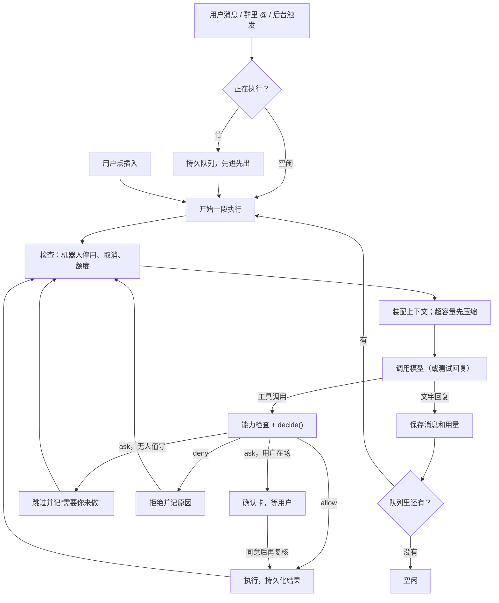

# Agent 运行

本文讲一次执行怎么跑：谁在执行、输入怎么排队、模型拿到什么、额度和恢复怎么算。能用哪些工具见[能力与权限](capabilities.md)，记忆的读写见[记忆](memory.md)，全局分层见[架构总览](README.md)。

## 三个身份

| 身份 | 是什么 | 不是什么 |
|---|---|---|
| 机器人（Bot） | 长期身份：名字、职责、版本化配置、能力开关。主管的 id 是 `chief`，界面叫 pipi | 不是一次执行 |
| 主会话 | 每个机器人一个，用户日常对话的地方；按每条输入计额 | 不能普通删除或取消，只能“清空并开始新会话” |
| Harness Task | 一段可恢复的执行：输入、固定的运行配置、等待项、用量、结果。主会话本身也是一个 Task；独立任务、委派、例行任务各是一个 Task | 不是待办事项，也不是一次模型调用 |

每个 Task 有一张任务卡（`TaskCard`），记录目标、执行者、主管、完成标准、阻塞和结果。

会话列表包含已有聊天活动的机器人主会话及独立任务，主会话仍通过自己的 Task ID 读取历史。协作时模型可见精简的活跃机器人目录，目录内容只是资料而非指令；可用工具与来源仍以服务端当轮复核为准。宿主按容量提供当前时间，帮助模型计算相对日期。

## 一次执行

循环在 `tasks.mjs` 的 `chatDefinition()`，一次模型请求的适配在 `model-reply.mjs`。一条输入可以触发多轮模型和工具调用，直到回复、等待或结束。

## 输入怎么处理

| 输入 | 行为 |
|---|---|
| 空闲时的普通消息 | 开始一段执行 |
| 忙时的普通消息 | 进持久队列，当前段结束后按顺序消费 |
| 插入（steer） | 在下一个安全边界插进当前执行，不直接改正在运行的状态 |
| 等待用户补充时的新消息 | 将原输入挂起，处理新消息；待答问题保留 |
| 确认结果、问题答复、协作结果 | 满足对应条件后恢复原输入；同一 Task 仍只有一个执行段 |
| 取消、停用、撤权 | 立即约束后续调度和工具调用 |

输入框里用 `/` 选的 Skill 只对这一条消息生效，处理完自动停用。主会话还可以对下一条消息选模型，选择固定在这条输入上，之后改模型不影响已排队的输入。

### 问题表单与请求恢复（ADR-027）

`report_blocker` 可提供 1–3 题文本、单选或多选表单。题目、选项、回答和版本保存在 TaskBlockers；普通新消息不是答案，表单也不授予能力或批准操作。

普通用户问题没有答案且队列出现新消息时，原输入让出 ChatInput，保留参数、任务限制、活动 Skill、主会话当前用量和压缩摘要。新消息在同一 Harness 执行；回答后原输入优先于普通队列恢复，当前回复段已经在执行时先等它到安全结束边界。主会话原模型和额度恢复，不重新激活新版本 Skill，也不重做成功工具。未回答的请求不会被当作已消费历史提供给其他输入。

用户可以稍后回答、按声明默认跳过非必需问题、调整或取消这次请求。调整将问题标为 superseded，取消仅结束该输入。受管子任务保留绑定主管、精确输入与版本校验，只允许对应处理人回答，不开放普通消息/调整绕过主管。

保留旧 awaitBlocker 检查点：没有新消息时继续持久等待，不额外调用模型；有新消息时转换为输入挂起。恢复信息、队列与回答同库持久化；精确重复回答返回原结果，过期版本和冲突回答拒绝。

## 持续目标

显式启动持续目标会创建独立根 Task，`executionPolicy.kind=continuous`；普通聊天不自动转换。目标、完成标准和限制仍以 `TaskCard.taskState` 为唯一真源。根 Task 与原输入保持不变，中间步骤、证据和核验决定保存于同一个 Harness 的 Documents 与对话事件。

`work_plan` 维护有依赖的阶段计划，不能降低用户标准；`work_submit` 只提交成果；`work_complete` 请求宿主检查，不能直接写成功状态。执行与核验分阶段进行，只有当前修订的标准、来源、成果和必要等待都核对通过才最终结算。阶段文字不会清输入、停用 Skill、发布最终子结果或把主会话派生工作标成功。

证据从真实宿主回执解引用，每轮与最终核验重新检查权限和来源；失败、未知写入、审批意图和未读大结果不能充当已完成事实。文件成果使用实际读取的内容版本，分页须属于相同整文件哈希；写入回执本身不证明内容质量。主观质量明确标记模型评审，不当作确定性证明。上下文使用有界进度投影，详细记录沿现有历史和结果分页回查。

根预算在模型或工具派发前持久预留，覆盖协调、执行、核验、压缩、重试和子任务；回执按原调用结算。未知 token 保留预留并阻止新调用，实际超过预留也保留真实用量。控制、权限与截止时间在派发前复核，暂停不清额度，取消后的迟到回执仍进入原审计。

可判定的临时模型故障最多额外重试三次，持久保存退避截止时间；重启不会重新起算或绕开额度。未知业务写入不自动重发。停滞依据新证据、标准核验和依赖解除判断，三次无进展触发重规划，两次重规划仍无进展则阻塞；等待回答、审批或子结果时由事件唤醒。

群组只作为入口，根目标与群会话分开；根协调者可以委派一层执行者。结果与目标/计划/步骤/提交修订绑定，必要子结果经接受后才能支持完成。目标修订保留旧子结果审计；旧修订不会永久占据新目标的待验列表。主会话换新保留独立根，最终结果交到新的同 Bot 主会话并去重。

这套机制不承诺通用任务能可靠运行八小时。当前验证范围按用户要求为代表性例子、中断恢复和关键边界；没有长时真实模型评估。

## 运行配置和迁移

创建 Task 时固定模型名、提示词和调用额度；工具、日历、规则不固定，每次调用实时读取。所以改能力开关立即对所有现有 Task 生效，改模型或提示词则只影响新 Task。

旧 Task 要换模型或提示词，用显式迁移（`task-migration.mjs`）：只在没有执行、没有待处理输入、没有等待项时进行，保留原身份、历史、用量和责任记录。机器人配置更新带 `expectedVersion`，保存为不可变版本。

## 上下文、容量和压缩

每次调用模型前，`task-context.mjs` 按这个顺序装配：固定运行配置 → 任务目标和规则 → 当前 Skill → 人格、记忆、共享偏好 → 近期对话 → 压缩摘要。记忆是低优先级材料，不能挤掉目标、约束和当前输入。

每个模型有上下文容量 `contextWindow`，没填就是 256K（256000 tokens），可填 8192 到 4000000，支持 K/M 写法（`shared/model-context.mjs`）。超出容量时在调用模型前同步压缩：

- 复用 pi-durable 1.3.0 的 `selectCut` 和 `serializeConversation` 切分与序列化，摘要用 Pi 的结构化检查点格式（`pi-compaction.mjs`、`context-compaction.mjs`）。
- 默认给输出留 16384 tokens，保留最近约 20000 tokens；小窗口按 20% 缩放。
- 当前输入不压缩；工具正文截到 2000 字符，思考文本省略；原始记录和补读权限不变。
- 压缩请求不带工具，不注入长期记忆。压缩会同时登记一个记忆整理作业（见[记忆](memory.md#自动整理)）。

工具结果超过 8KiB 时只给模型一个引用，模型用 `tool_result_read` 分页补读，补读时重新检查权限。

## 额度

每个 Task 记录模型调用、工具调用和 token 用量。用完额度后 Task 进入“受限”等待，用户明确提额后在原 Task 继续。不会新建 Task 来重置额度或掩盖失败。主会话按每条输入计额。

## 协作

| 方式 | 怎么做 |
|---|---|
| 委派 | `task_create` / `task_assign` 建父子 Task；目标机器人用自己的能力和权限执行（`collaboration.mjs`） |
| 验收和返工 | 协调者按精确结果修订接受或返工；持续目标最多返工两次，超过交给用户，普通委派保持原有语义（`review-tools.mjs`） |
| 阻塞上报 | 缺信息时 `report_blocker`，逐级上报；需要确认的动作只能由用户批准，主管不能代批（`blockers.mjs`） |
| 群聊 | 管理员机器人接收普通消息；单目标 @ 从那条消息 fork 必要上下文；结果带原来源，不把定向材料广播给其他成员（`groups.mjs`） |
| 共享信息 | `shared_publish` / `shared_read` 带来源，回读时实时检查（`shared-information.mjs`） |
| 主管管理机器人 | `bot_manage` 创建、配置、停用机器人；不能停用主管自己（`chief-management.mjs`） |

主会话派出去的任务，其确认、补充、结束以系统卡显示在主会话里；结束概述在下一轮带入。

## 会话删除和换新

普通会话删除先写持久停止标记，再隐藏列表、详情和发送入口；审计不物理擦除。归档只是隐藏。主会话用“清空并开始新会话”（clear-main）：停掉旧入口，原子创建同一机器人的新上下文；机器人、独立子 Task 和审计保留，之后到达的子任务结果接到新的主会话（`session-lifecycle.mjs`、`main-session.mjs`）。

## 副作用和恢复

恢复复用原 Task、等待项、输入、Operation、确认和累计用量，不创建替代执行。

1. 明确成功的动作不重复执行。
2. 结果不确定时，优先按工具契约查询；查不到不代表没发生。
3. 只有工具明确支持幂等、且原参数仍成立时，才按原标识有限重试。
4. 没有可靠查询或幂等保证时保留 `unknown`，等人核查。
5. 每次恢复、查询、派发都重新检查权限、额度、取消和原确认。

原生 bash/write/edit 也先持久登记派发意图；进程中断后没有回执就返回 `NATIVE_OUTCOME_UNKNOWN`，跳过原计划的剩余步骤，不自动重放。

## 源码入口

[tasks.mjs](../../my-app/server/tasks.mjs)（装配和循环）· [model-reply.mjs](../../my-app/server/model-reply.mjs) · [task-context.mjs](../../my-app/server/task-context.mjs) · [context-compaction.mjs](../../my-app/server/context-compaction.mjs) · [task-migration.mjs](../../my-app/server/task-migration.mjs) · [steering.mjs](../../my-app/server/steering.mjs) · [collaboration.mjs](../../my-app/server/collaboration.mjs) · [main-session.mjs](../../my-app/server/main-session.mjs) · [session-lifecycle.mjs](../../my-app/server/session-lifecycle.mjs)
