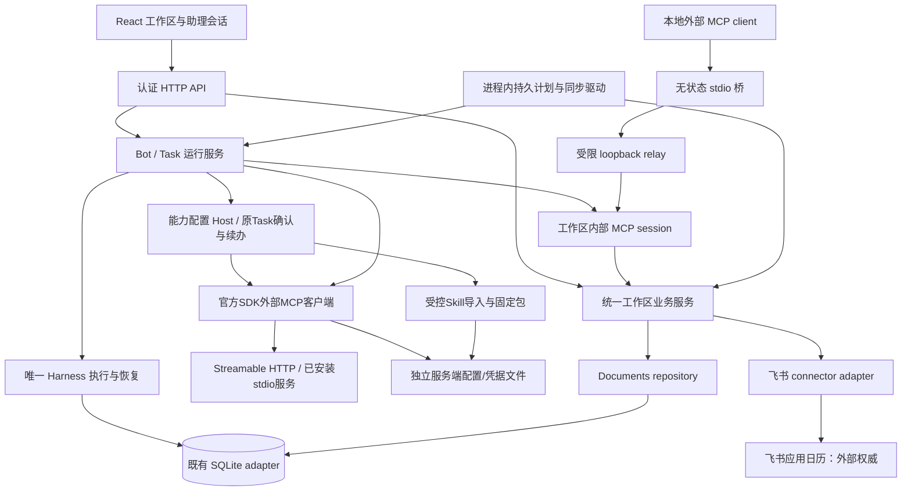
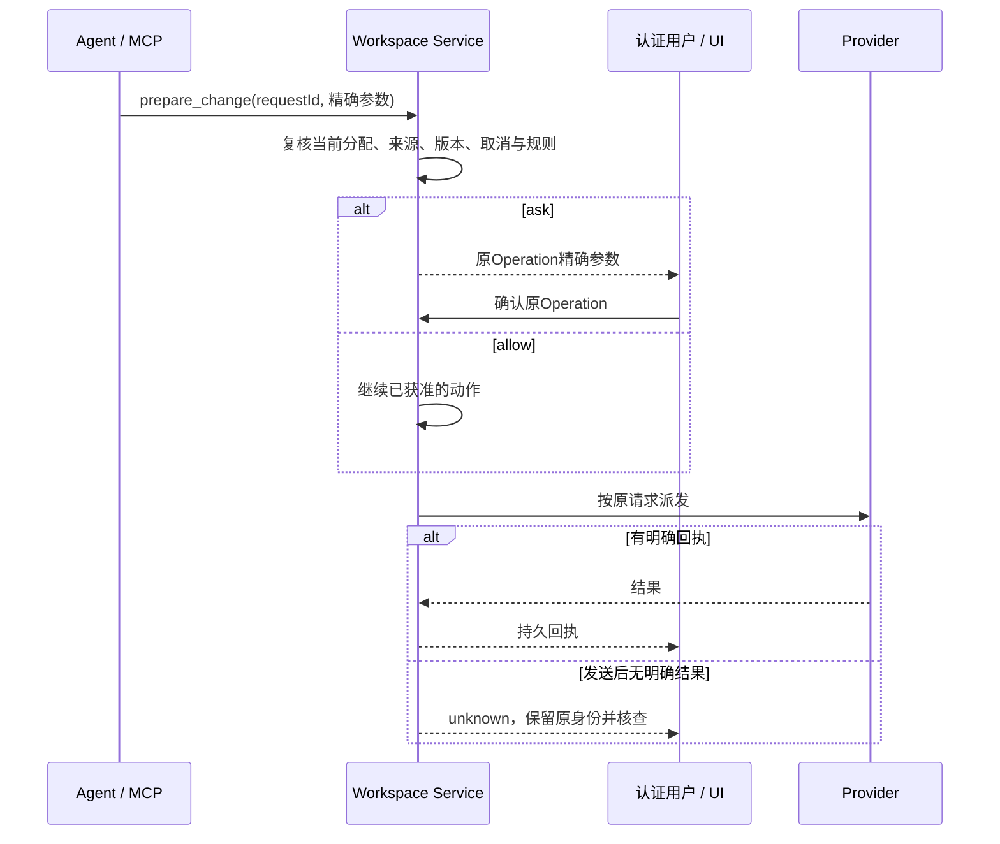

# 系统架构与数据流

## 组件边界

一个Node后端独占一个数据库和Harness；模型/MCP凭据与Skill固定包另在受控服务端文件持久化，秘密不进SQLite、模型参数或公开回执。UI、API、MCP 和后台不能各自复制业务规则；外部 stdio 桥不能打开 SQLite。浏览器不是调度器，停机期间也没有另一个云服务代替执行。

## 外部变更确认

上图是已登记工作区写入的allow/ask流程；deny不派发。外部MCP动态工具与配置Host保守要求精确批准。UI手动本地CRUD不调用模型；Agent建议不是用户批准。外部不确定结果不能通过新 requestId 自动重试。

## 数据与控制流
- 本地 Event/Todo 与 Operation 为本地权威；外部事件正文来自 provider，缓存附版本、时间与覆盖信息。
- 同步负责“知道外部发生了什么”；Schedule/Occurrence 负责“何时启动什么”。两者不是同一个状态机。
- 普通提醒走确定性动作，不使用模型；只读简报关联原 Harness Task，执行状态仍由 Harness 提供。
- 来源撤权使后续读取、派发和敏感内容显示失效，但不销毁历史审计或真实迟到回执。新认证输入可退役旧无效MCP来源派生上下文、清摘要后继续新合法请求。
- 主会话换新使用既有Task/MainSessions映射及持久交接记录，不另建会话执行器；独立子Task保留，窗口内结果及去重跨重启接续。

## 实现入口
| 责任 | 源码 |
|---|---|
| HTTP 与认证路由 | [app.mjs](../../my-app/server/app.mjs) |
| Store 与 Harness 装配 | [tasks.mjs](../../my-app/server/tasks.mjs) |
| 业务服务与事务 | [workspace-service.mjs](../../my-app/server/workspace-service.mjs) |
| 存储与记录类型 | [workspace-repository.mjs](../../my-app/server/workspace-repository.mjs) · [workspace-schema.mjs](../../my-app/server/workspace-schema.mjs) |
| 外部MCP与配置Host | [external-mcp.mjs](../../my-app/server/external-mcp.mjs) · [capability-management.mjs](../../my-app/server/capability-management.mjs) · [capability-assignments.mjs](../../my-app/server/capability-assignments.mjs) |
| 会话生命周期 | [session-lifecycle.mjs](../../my-app/server/session-lifecycle.mjs) · [main-session.mjs](../../my-app/server/main-session.mjs) |
| MCP 工具与协议 | [workspace-tools.mjs](../../my-app/server/workspace-tools.mjs) · [workspace-mcp-protocol.mjs](../../my-app/server/workspace-mcp-protocol.mjs) |
| 定时、同步、提醒 | [workspace-schedule.mjs](../../my-app/server/workspace-schedule.mjs) · [workspace-sync.mjs](../../my-app/server/workspace-sync.mjs) · [workspace-reminders.mjs](../../my-app/server/workspace-reminders.mjs) |
