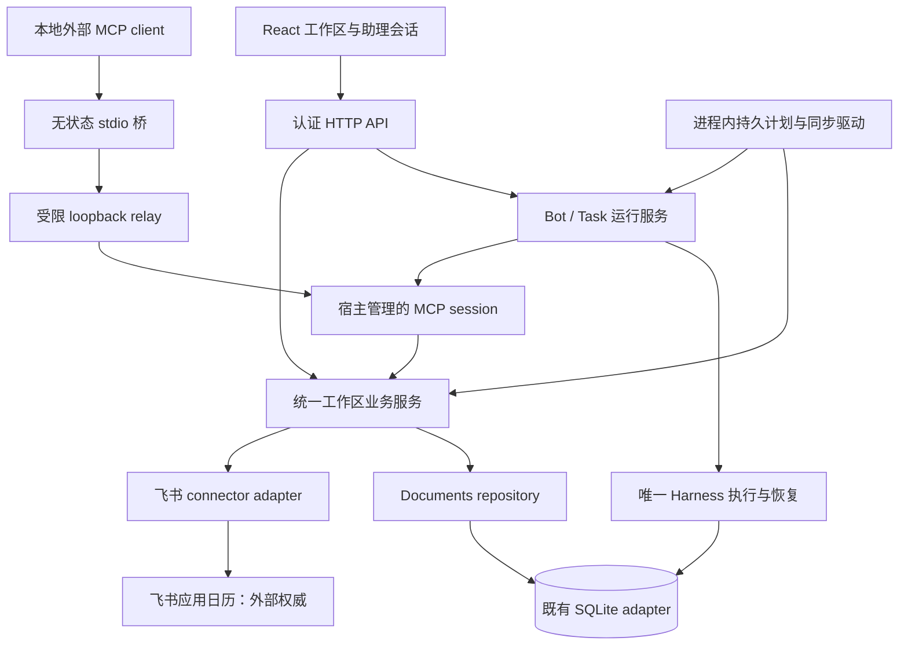
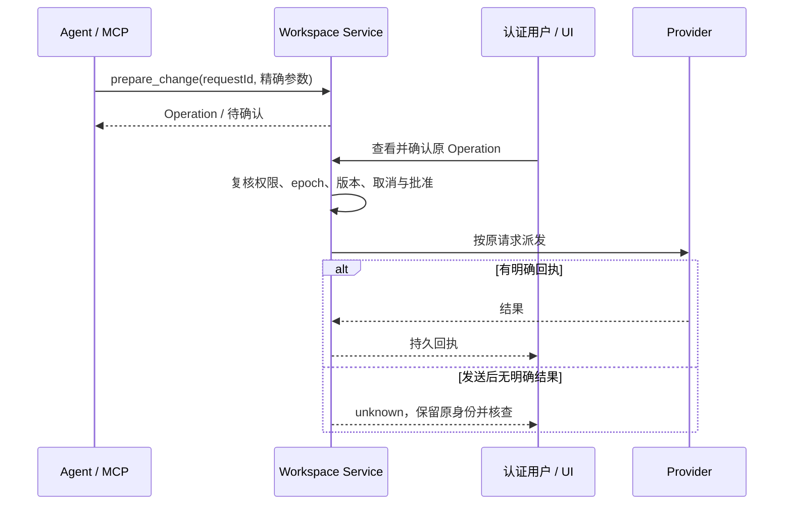

# 系统架构与数据流

## 组件边界

一个 Node 后端独占一个数据库和 Harness。UI、API、MCP 和后台不能各自复制业务规则；外部 stdio 桥不能打开 SQLite。浏览器不是调度器，停机期间也没有另一个云服务代替执行。

## 外部变更确认

UI 手动本地 CRUD 不调用模型；Agent 的建议不是用户批准。外部不确定结果不能通过新 requestId 自动重试。

## 数据与控制流
- 本地 Event/Todo 与 Operation 为本地权威；外部事件正文来自 provider，缓存附版本、时间与覆盖信息。
- 同步负责“知道外部发生了什么”；Schedule/Occurrence 负责“何时启动什么”。两者不是同一个状态机。
- 普通提醒走确定性动作，不使用模型；只读简报关联原 Harness Task，执行状态仍由 Harness 提供。
- 来源撤权使后续读取、派发和敏感内容显示失效，但不销毁历史审计或真实迟到回执。

## 实现入口
| 责任 | 源码 |
|---|---|
| HTTP 与认证路由 | [app.mjs](../../my-app/server/app.mjs) |
| Store 与 Harness 装配 | [tasks.mjs](../../my-app/server/tasks.mjs) |
| 业务服务与事务 | [workspace-service.mjs](../../my-app/server/workspace-service.mjs) |
| 存储与记录类型 | [workspace-repository.mjs](../../my-app/server/workspace-repository.mjs) · [workspace-schema.mjs](../../my-app/server/workspace-schema.mjs) |
| MCP 工具与协议 | [workspace-tools.mjs](../../my-app/server/workspace-tools.mjs) · [workspace-mcp-protocol.mjs](../../my-app/server/workspace-mcp-protocol.mjs) |
| 定时、同步、提醒 | [workspace-schedule.mjs](../../my-app/server/workspace-schedule.mjs) · [workspace-sync.mjs](../../my-app/server/workspace-sync.mjs) · [workspace-reminders.mjs](../../my-app/server/workspace-reminders.mjs) |
