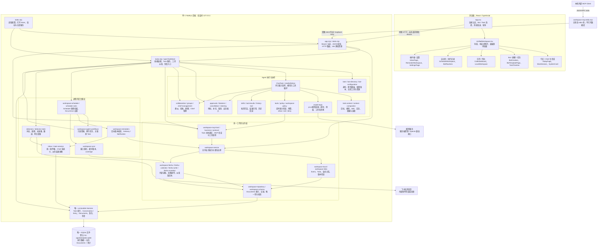
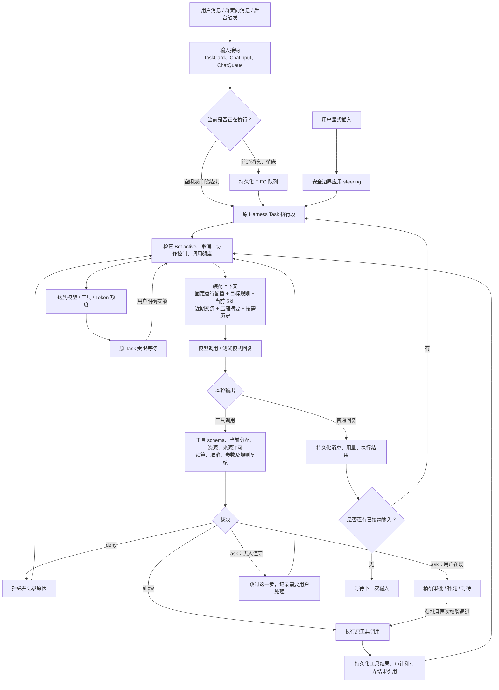
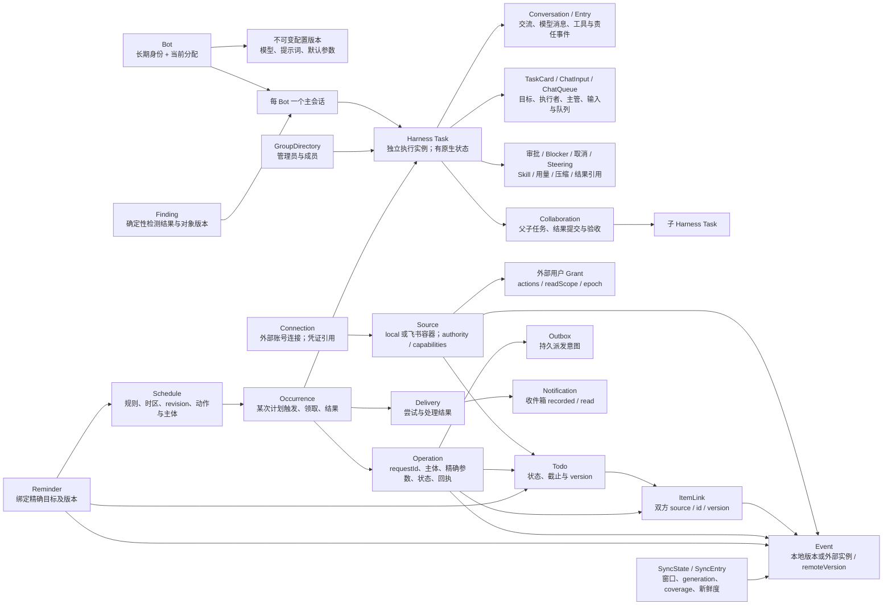
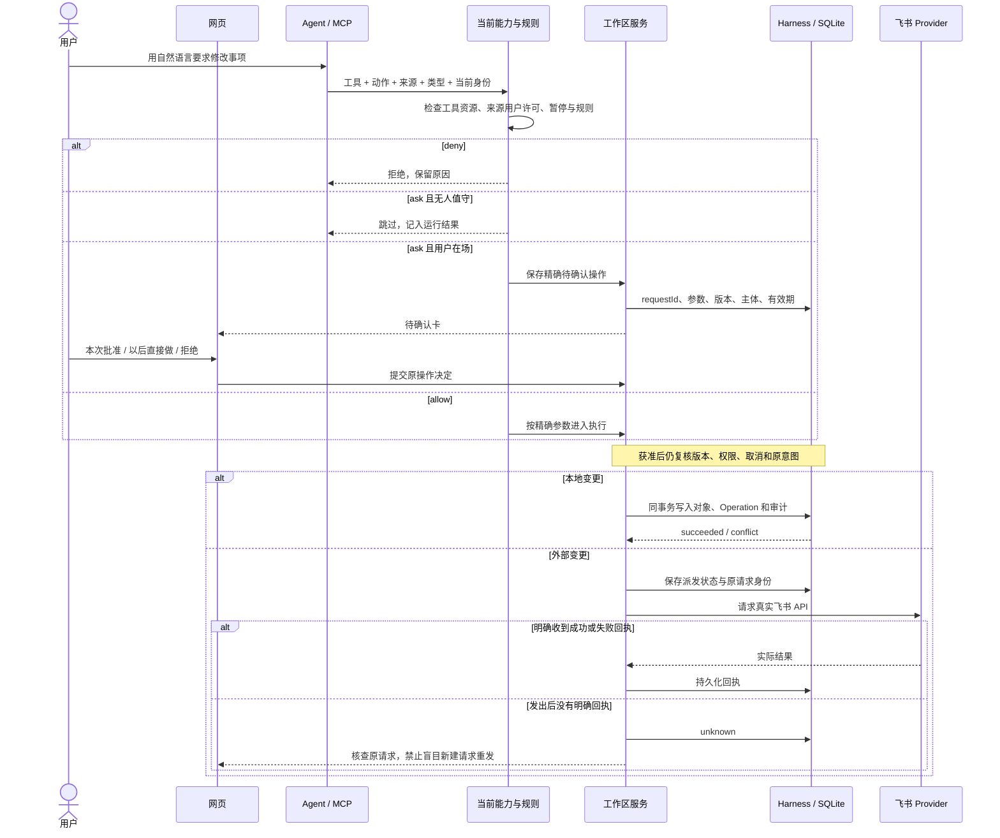
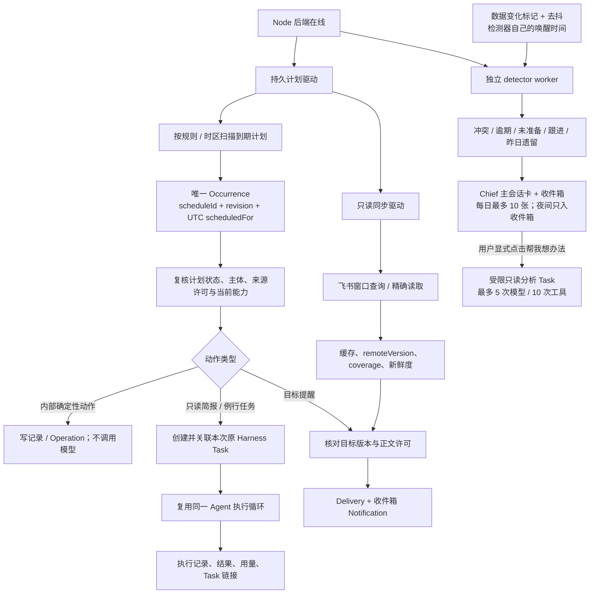

# Pidot 项目导读：架构、功能与用法

> 按 2026-10-25 当前工作区源码整理，包含尚未提交的改动。本文用于整体理解和定位代码；具体产品规则、接口字段和启动配置分别以链接的正式文档为准。权限采用 [ADR-014](decisions/README.md#adr-014-实时权限与直接做先问)。

## 1. 项目是什么

Pidot 是运行在本机的多 Bot 个人助理系统：用户在网页中管理待办和日程，也可以与 Chief 或专业 Bot 对话，让它们调用工具、协作和执行例行任务。会话、执行进度、审批、业务对象和计划都会持久化。

当前形态是 **React 网页 + 一个 Node.js 后端 + 一个 SQLite 数据库**。后端内部包含 Agent 执行、工作区业务、定时、同步、提醒和 MCP 接入，没有独立微服务集群。网页关闭后，只要后端进程仍在运行，后台工作就能继续；后端停机期间不会执行。

### 技术栈及职责

| 层次 | 技术 | 在本项目中的作用 |
|---|---|---|
| 前端 | React 19、TypeScript 6、Vite 8 | 网页组件、交互、类型检查和构建 |
| HTTP 服务 | Node.js 22.22.1+、原生 HTTP、ESM `.mjs` | 本机 API、认证、静态文件服务 |
| 持久执行 | `@earendil-works/pi-durable` 1.3.0 | Harness、Task、Conversation、Documents、恢复 |
| 模型适配 | `@earendil-works/pi-ai` 1.3.0 | OpenAI 兼容模型调用、工具调用消息转换 |
| 运行基础 | `@earendil-works/chord` 1.3.0 | Context 等执行基础设施 |
| 存储 | Node 内置 SQLite + pi-durable SQLite adapter | 同库保存执行记录与业务 Documents |
| 工具协议 | JSON-RPC MCP，兼容基线 `2025-11-25` | 内部 Agent 工具会话及本机 stdio client |
| 外部业务 | 飞书应用日历 API | 一个显式绑定的日历来源 |
| 工程 | pnpm 11.21.0、Node test、oxlint | 安装、测试、静态检查 |

## 2. 详细架构图

### 2.1 部署、模块与依赖全图

实线表示主要调用或数据访问方向；图中的后台组件均运行在同一个 Node 进程中。



关键边界：UI 手动操作可直接调用业务 API，无需先经过模型；Agent 调用工作区时通过内部 MCP；stdio 桥只转发到同一后端。`tasks.mjs` 是目前较集中的装配与运行入口，业务实现再拆分到各领域模块。

### 2.2 Agent 内部执行结构



模型循环主要在 `tasks.mjs` 的 `chatDefinition()` 中；`model-reply.mjs` 负责一次模型请求的适配。一次用户输入可能经历多轮模型与工具调用。主会话按输入计额，派生 Task 保留自身累计用量；不能通过自动新建 Task 掩盖原任务的失败或额度耗尽。

### 2.3 数据对象与关系图

下图是领域关系，**不是手工建立的一组 SQL 业务表**。工作区对象通过 Harness Documents / Document families 存储在同一 SQLite 中。



需要分清五个概念：

| 概念 | 表示什么 | 示例 |
|---|---|---|
| Bot | 谁来做 | Chief、日程助理 |
| Harness Task | 一段可恢复的 Agent 执行 | “整理本周待办并给出建议” |
| Todo / Event | 用户实际管理的业务事项 | “交报告” / “周五 14 点开会” |
| Schedule / Occurrence | 何时触发 / 哪一次触发 | 每天 8 点 / 今天 8 点的那一次 |
| Operation | 一次精确业务操作及其回执 | 修改某条日程，使用原 requestId 查询结果 |

对象基本身份使用 `ownerId + sourceId + id`；版本控制用于避免覆盖过时对象。业务架构称 V2，但当前工作区数据 `schemaVersion` 为 **1**。兼容字段仍可能存在于存储定义，不代表旧 Bot Grant、档位或 Task 权限快照仍是当前授权机制。

### 2.4 写操作、审批和不确定结果



此图描述 Bot / MCP 写入。用户手动本地 CRUD 由认证用户显式提交，不调用模型。`workspace.prepare_change` 名字带 prepare，但在当前规则允许时可以直接应用，不能把“所有写入都必须再点批准”当作现行行为；`workspace.prepare_schedule` 仍只生成不可执行草案。

外部 Provider 无法与本地 SQLite 原子提交。`unknown` 表示确实不知道是否生效，查询不到不等于没有发生。外部操作不提供通用 exactly-once 或原子 CAS 承诺。

### 2.5 后台计划、同步与主动提醒



同步负责获取外部事实；计划负责何时启动动作；检测器负责从结构化事实发现问题。三者职责不同。普通提醒和检测都不调用模型，只有明确的 Agent 工作流或分析任务才调用模型。

## 3. 功能、用法与简要实现

以下自然语言均为使用示例，不是保证固定输出的命令。模型能否完成动作，取决于 Bot 当前工具、资源、来源许可及规则。

### 3.1 入口与日常使用

| 功能 | 怎么用 | 简要实现 / 主要代码 |
|---|---|---|
| 连接本地服务 | 启动后打开网页，输入本机 API token；断开连接不会删除数据 | `App.tsx` 在当前标签页 sessionStorage 保存 token；`app.mjs` 校验 Bearer |
| 今天首页 | 查看当日日程、到期待办和待处理事项；直接在首页向 Chief 发消息 | `TodayPage.tsx` 汇总数据；首页复用 Chief 主会话 |
| 创建 Bot | 侧栏新建 Bot，先填名字；高级设置调整职责与模型 | `BotCreation.tsx`、`bot-templates.mjs` 按名字确定性匹配职责，不调用模型 |
| Bot 主会话 | 打开 Bot 持续交流，如“整理一下今天需要做的事” | `main-session.mjs` 确保每个 Bot 一个主会话；长任务可派生执行 |
| 独立任务 | 在 Bot 下开始会话，或让主会话派生长任务；查看目标与完成标准 | `task-creation.mjs` 创建原生 Harness Task、Conversation 和 TaskCard |
| 队列与插入 | 执行中继续发送会排队；需要改变当前方向时显式插入 | `ChatQueue` 持久 FIFO；`steering.mjs` 在安全边界应用 |
| 时间线与历史 | 会话顶部切到时间线，看模型回合、工具、审批、补充和结果 | `TaskTimeline.tsx`、`timeline.mjs` 从持久事件构建视图 |
| 归档、取消与提额 | 归档隐藏会话；取消停止后续工作；额度耗尽时明确提高上限 | `TaskArchive` 与 `cancellation.mjs` 分开；`CallUsage` 记录用量。主会话不能取消 |

### 3.2 日程、待办和来源

| 功能 | 怎么用 | 简要实现 / 主要代码 |
|---|---|---|
| 本地待办 | 在“待办”新增、编辑、完成或删除，填写截止时间和时区 | `LocalWorkspace.tsx` → `workspace-local.mjs`；版本检查与 Operation 同事务保存，无模型 |
| 本地日程 | 在“日历”管理普通定时事件，填写起止时间和时区 | `CalendarBoard.tsx`、`workspace-local.mjs` 保存 Event；不支持全天/重复写 |
| 待办关联日程 | 在待办关联区选择双方，核对具体对象后提交 | `workspace-links.mjs` 保存 ItemLink 与双方版本；删除不级联 |
| 飞书连接和许可 | “设置 → 来源与状态 → 飞书日历来源”查看绑定、启用同步并设置来源许可；凭证按运维文档在服务端配置 | `ExternalWorkspace.tsx`、`feishu-calendar.mjs`、`workspace-feishu.mjs`；当前仅一个显式绑定来源 |
| 飞书读取和修改 | 为 Bot 勾选对应工具和来源资源，再问“查询这段时间的飞书日程”；新建/修改按规则执行，默认删除先问 | `feishu-calendar.mjs`、`feishu-write.mjs`、`feishu-mutation.mjs`；真实 Provider 读写与回执 |
| 窗口同步 | 在来源面板查看同步窗口、成功时间、coverage 和错误 | `workspace-sync.mjs` 只读重扫；失败有限退避。缓存不是外部写回 |
| 本地自动修改撤销 | 在自动执行卡或收件箱中检查原操作并撤销 | `workspace-mcp-business.mjs` 用当前对象版本验证；版本变化不能直接撤销；外部写入不可撤销 |

待办截止时间不等于占用日历时段。飞书来源只给 busy 权限时，服务端只返回忙闲时段，不返回事件正文；外部数据不完整或过期时不能当成最新完整日历。

### 3.3 工具、规则和 Skill

| 功能 | 怎么用 | 简要实现 / 主要代码 |
|---|---|---|
| Bot 工具与资源 | 侧栏“Bot 模板”打开 Bot 编辑，勾选工具及 `workspace:local` 等资源 | `BotConfiguration.tsx`、`bot-configuration.mjs`；更改从所有已有 Task 的下一次调用起生效 |
| 直接做 / 先问 / 禁止 | 在 Bot 规则中按工具、动作、来源和类型设置 | `policy.mjs` 选最具体规则，同级 `deny > ask > allow`；工具和来源许可检查仍先执行 |
| 审批与补充 | 从输入框上方、主会话镜像卡或收件箱处理；批准前查看精确内容 | `approvals.mjs`、`blockers.mjs`、`SystemCard.tsx`；同一操作身份持久化 |
| 全局暂停 | 在设置暂停全部自动化；也可让有权限的 Bot 暂停 | `policy.mjs` 把写入 allow 降为 ask，停止例行任务与事件触发；恢复只由用户操作，不补跑 |
| Skill 方法加载 | 输入 `/` 选择本条消息的方法，或由 Bot 按需选择 | `skills.mjs` 扫描本地 manifest，核对当前依赖，按输入激活/退出；Skill 不授予权限 |
| 模型配置与迁移 | 在 Bot 编辑模型；旧任务要改模型/提示词时，查看配置差异并显式迁移 | `task-migration.mjs` 在安全边界更新运行配置；工具、资源、规则实时生效，不用迁移 |

当前默认：读取与内部协作直接允许；已获能力的写入默认直接执行，只有工作区删除、飞书删除、停用 Bot 默认先问。未知工具/动作拒绝。暂停中及 unknown 后重做的审批不提供“以后直接做”。无人值守的 routine/event/detector 遇到 ask 会跳过并记录“这一步需要你来做”，不会一直挂审批。

仓库内置 Skill 为 **日程冲突分析**（`calendar-conflict-analysis`），面向日程 Bot 的模拟日程工具及 `mock:personal`，不是任意真实飞书日历的通用写入方法。

### 3.4 多 Bot、Chief 和群聊

| 功能 | 怎么用 | 简要实现 / 主要代码 |
|---|---|---|
| Chief 管理 Bot | 向 Chief 说“创建一个叫学习助理的 Bot”，再让它分配工作 | `chief-management.mjs`、`management-tools.mjs`；创建/配置默认直接执行，停用默认询问；不能停用 Chief 自身 |
| 跨 Bot 委派 | 在具备协作工具的任务中明确目标、执行者与完成标准 | `collaboration.mjs`、`collaboration-tools.mjs` 创建父子 Task 关系；目标 Bot 独立校验权限 |
| 结果验收和返工 | 主管接受提交或给出修改意见；在协作面板跟踪 | `review-tools.mjs` 和协作记录保存结果与责任事件；最多两次返工，超限交用户 |
| 阻塞上报 | Bot 缺信息或无法继续时报告 blocker，用户/主管补充或上报 | `blockers.mjs`、`blocker-actions.mjs`；解决关联等待后恢复原 Task，主管不能代替用户批准 |
| 群聊及单目标 @ | 创建群并选择管理员和成员；普通消息交管理员，定向消息选择一个成员 | `groups.mjs`、`group-fork-context.mjs` 从明确消息点派生必要上下文 |
| 共享信息与来源追踪 | 通过共享信息和协作面板检查哪些资料被引用、结果来自谁 | `shared-information.mjs`、`group-result-provenance.mjs` 附带来源；回读实时检查，受限材料不广播给其他成员 |

### 3.5 自动化、提醒和 MCP

| 功能 | 怎么用 | 简要实现 / 主要代码 |
|---|---|---|
| 持久定时计划 | “自动化 → 定时任务”配置一次性、每日或固定间隔与时区 | `workspace-schedule-rules.mjs` 计算时点；`workspace-schedule.mjs` 持久去重与派发 |
| Bot 例行任务 | Bot 页设置提示、频率和是否允许改动（当前表单固定本地来源）；也可在对话里提出；可测试、暂停、恢复或取消 | `BotRoutines.tsx`、`routine_propose`、`workspace-agent-workflows.mjs`；`writes=true` 才开放工作区改动，仍服从当前能力与规则 |
| 事件触发 | 在 Bot 例行任务中选择待办到期、日程变更或本 Bot 任务结束 | 同一工作流驱动保存事件游标、合并触发，避免由自己的改动无限自触发 |
| 只读 Agent 简报 | 在自动化页创建固定 Bot、来源、提示和额度的简报 | `workspace-agent-workflows.mjs` 为每次触发关联原 Task；失败不新建替代 Task 盲重试 |
| 执行记录 / 接着聊 | “自动化 → 执行记录”查看状态、用量和原 Task；Bot 例行结果可接着聊 | `ScheduleWorkspace.tsx`、`main-session.mjs`；后续讨论另开派生任务，不篡改原次执行 |
| 事项提醒与通知 | 在收件箱的提醒区设置目标和提醒时间；在收件箱查看、标记已读 | `workspace-reminders.mjs` 触发前核对目标版本；保存 Delivery、Notification |
| 主动发现问题 | 查看 Chief 主会话或收件箱的冲突、逾期等卡片；可处理、忽略或关闭某类提醒 | `detectors.mjs` 纯代码读取结构化数据，按对象版本去重；每日最多推 10 张卡，22:00–08:00 只入收件箱 |
| 帮我想办法 | 在“设置 → 主动提醒”启用后，对发现的问题点击分析 | `findingAssist` 只读派生 Task，最多 5 次模型和 10 次工具；检测器本身仍不调模型 |
| 外部本机 MCP 接入 | “设置 → 本机工具连接”发放凭证，再按工程文档启动 stdio 桥；不用后撤销 | `workspace-mcp-stdio.mjs` 转发到私有 relay；凭证受 Bot、来源、动作、读取范围、有效期约束 |

计划支持 `at`、`daily` 和 60 秒至一年整数秒的 `interval`，不是完整 cron/RRULE；上限为 200 个计划、1000 扫描预算。测试运行和旧只读简报保持只读。通知目前只有应用内收件箱，`recorded/read` 不等于系统推送或用户实际收到。

MCP 实际工作区工具为 `workspace.list`、`workspace.get`、`workspace.prepare_change`、`workspace.prepare_schedule`、`workspace.operation_status`。模型端的 `workspace_*` 名字只是适配别名，服务端恢复为规范 MCP 名字，不是另一套业务工具。

## 4. 建议的上手顺序

1. 按 [工程 README](../my-app/README.md) 配置本地 API token 并启动，先确认当前是真实模型还是测试模式。
2. 在“待办”和“日历”手动建少量本地事项，理解 Todo、Event 及显式关联。
3. 回到首页向 Chief 提问；打开 Bot 主会话和时间线，观察输入、模型、工具与结果。
4. 新建一个 Bot，在“Bot 模板”检查工具、资源、规则；先用本地来源验证直接做与先问。
5. 创建例行任务，先测试运行，再启用真实计划；在执行记录中找到原 Task。
6. 需要真实外部日历时再接飞书；需要外部工具客户端时再发放独立 stdio 凭证。

启动、环境变量与凭证配置的唯一详细步骤见 [工程 README](../my-app/README.md)。生产式本地启动为在 `my-app` 下运行 `pnpm build`、`pnpm start:api`；开发时分别运行 `pnpm dev:api` 和 `pnpm dev`。

## 5. 代码目录和阅读路线

```text
pidot/
├── README.md                  项目入口
├── AGENT.md                   协作与文档规范
├── NEXT_STAGE.md              当前状态与授权边界
├── plans/                     计划：active / done / backlog
├── docs/
│   ├── project-guide.md       本文：整体导读
│   ├── product/               产品定义、当前能力边界
│   ├── architecture/          架构专题
│   ├── interfaces/            HTTP / MCP 契约
│   ├── decisions/             ADR 技术决策
│   └── engineering/           运维与排障
├── my-app/
│   ├── src/                   React 页面、组件、前端辅助模块与样式
│   ├── server/                Node 服务、领域逻辑、Agent 运行与测试
│   │   ├── index.mjs          进程入口
│   │   ├── app.mjs            HTTP 入口
│   │   ├── tasks.mjs          Store 装配与 Agent 执行核心
│   │   ├── workspace-*.mjs    工作区业务、计划、同步、MCP
│   │   ├── feishu-*.mjs       飞书适配
│   │   ├── skills/            Skill manifest、正文与引用资料
│   │   ├── fixtures/          测试进程与模拟依赖
│   │   └── *.test.mjs         Node 自动化测试
│   ├── data/                  默认 SQLite / WAL / SHM，运行生成
│   ├── dist/                  构建生成的静态资源
│   └── .env.example           配置示例；实际 .env 不应分享
└── .scratch/                  本地实施过程与原始证据（不进仓库）
```

推荐源码阅读顺序：

1. [App.tsx](../my-app/src/App.tsx) → [UnifiedWorkspace.tsx](../my-app/src/UnifiedWorkspace.tsx)：页面怎么组织、如何选择任务和发消息。
2. [index.mjs](../my-app/server/index.mjs) → [app.mjs](../my-app/server/app.mjs)：服务如何启动、认证、路由。
3. [tasks.mjs](../my-app/server/tasks.mjs)：先看 `openTaskStore()` 的装配，再看 `chatDefinition()` 的执行循环。
4. [task-context.mjs](../my-app/server/task-context.mjs) → [model-reply.mjs](../my-app/server/model-reply.mjs) → [tools.mjs](../my-app/server/tools.mjs) → [policy.mjs](../my-app/server/policy.mjs)：模型拿到什么、工具如何获准执行。
5. [workspace-service.mjs](../my-app/server/workspace-service.mjs) → [workspace-local.mjs](../my-app/server/workspace-local.mjs) → [workspace-repository.mjs](../my-app/server/workspace-repository.mjs)：无模型业务链路、事务与数据。
6. [workspace-mcp-business.mjs](../my-app/server/workspace-mcp-business.mjs) → [workspace-feishu.mjs](../my-app/server/workspace-feishu.mjs)：Agent 与外部变更如何共用边界。
7. [workspace-schedule.mjs](../my-app/server/workspace-schedule.mjs) → [workspace-agent-workflows.mjs](../my-app/server/workspace-agent-workflows.mjs) → [detectors.mjs](../my-app/server/detectors.mjs)：后台怎么触发和留痕。
8. [collaboration.mjs](../my-app/server/collaboration.mjs) → [groups.mjs](../my-app/server/groups.mjs)：多 Bot 如何交接责任和上下文。

## 6. 当前边界和文档阅读注意

- 仅本机单用户、单进程独占数据库；当前没有公网部署、多租户、手机 App 或云端常驻调度承诺。
- 外部连接器只有当前飞书应用日历；没有邮件或外部待办。普通事件之外的邀请、会议室、重复/例外、全天写不支持。
- 外部 unknown 必须保留并核查，不能盲重试；本地撤销有版本条件，外部写入不可撤销。
- 对话摘要与上下文压缩已实现，但不等于完整长期记忆产品。
- 部分旧专题正文仍含“八页导航”“能力池/档位/Task 权限快照”“主会话只读”“所有 prepare 都必须人工确认”等描述。当前界面以 `workspace-navigation.mjs` 的七个视图为准：今天、日历、待办、收件箱、自动化、设置、任务；当前权限以 `policy.mjs`、`workspace-mcp-business.mjs` 及 ADR-014 为准。历史方案和历史测试数字不能当成当前重新验收结果。

继续查阅：[功能范围](product/mvp-scope.md)、[Agent 专题](architecture/agent-runtime.md)、[HTTP 契约](interfaces/http-api.md)、[运行手册](engineering/operations.md)。本文依据源码与现有测试用例梳理，没有启动真实模型、修改正式数据库或执行飞书写入，也未重新运行业务测试。
