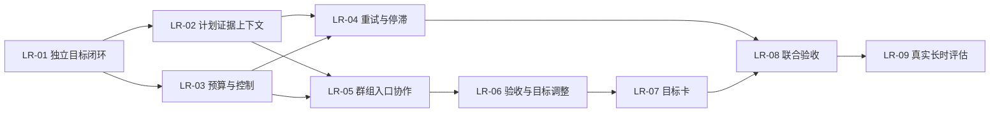

# 长任务持续执行计划

日期：2026-11-02（Asia/Shanghai）。
状态：**已完成分工、计划和分票；代码实施未开始。**
依据：用户要求“确定分工开始创建计划并分票”，以及[前期研究](../../backlog/2026-11-01-long-running-agent/README.md)。本轮交付是计划与本地票据，尚未派出子 Agent。

## 1. 交付目标

用户从群组或机器人私聊启动一项通用复杂任务，系统在原 Task 内持续执行、检查结果和调整计划，直至达到完成标准、明确阻塞、预算耗尽或用户停止。关闭网页不影响服务在线期间的执行；重启后依据持久状态恢复，不能靠反复发送“继续”维持工作。

群组是入口与协作展示；每个目标拥有独立的根 Task，根协调者可以自己执行或委派一层执行者。保留一个 Node 进程、一个 SQLite、一个 pi-durable Harness。

本阶段交付可验证的持续推进机制。八小时真实效果属于 LR-09 的独立评估结果，不以进程在线时长、等待或模型调用次数代替。

## 2. 文档与状态入口

- [设计契约](CONTRACTS.md)：首版约定；这些接口和字段目前尚未实现。
- [验收矩阵](ACCEPTANCE.md)：跨票行为与证据要求。
- [本地票据索引](../../../.scratch/long-running-agent/issues/README.md)：逐票正文、领取与直接依赖。
- [机器可读票据清单](../../../.scratch/long-running-agent/tickets.json)：唯一逐票执行状态；票据正文不重复维护动态状态。
- [本地工作记录](../../../.scratch/long-running-agent/task_plan.md)：规划过程与实施后日志。

正式范围保存在 plans；逐票文件和证据遵守仓库规范放在忽略的 .scratch。克隆仓库不会带上本地 tracker，正式范围和验收矩阵仍可独立阅读。

## 3. 固定设计选择

| 编号 | 选择 |
|---|---|
| D01 | 复用 TaskCard.taskState 的目标、标准和约束，新增进度 Document，不复制目标真源。 |
| D02 | 持续执行是显式启动选项；旧 Task 和普通消息默认保持当前聊天行为。 |
| D03 | 阶段提交与整个工作结束分开，finishReply 的最终结算只在目标结束时发生。 |
| D04 | 根 Task/rootInputId 稳定；内部阶段写系统事件，不伪造新用户输入，不通过新 Task 重置额度。 |
| D05 | 规划、执行和核验都是原 Harness 中的阶段或子 Task；不新增执行引擎、队列数据库或轮询模型的定时器。 |
| D06 | 群组关联独立目标根 Task；根协调者委派一层执行者，执行者不得继续委派。 |
| D07 | 群管理员负责该群发起的目标；私聊当前 Bot 负责其目标，不把所有工作归给 pipi。 |
| D08 | 结果必须关联标准、阶段、目标修订和证据；提交、自报、验收和整体完成分别表达。 |
| D09 | 根总额度覆盖协调、执行、核验、压缩、重试和子任务；暂停/取消/撤权先于新派发。 |
| D10 | 暂停、等待、额度受限、失败、取消和完成分开；未知写入结果沿用原查询/确认规则。 |
| D11 | 第一版使用一名协调者和按需执行者；关键阶段可独立评审，不强制固定多 Agent 阵容。 |
| D12 | 每票自身包含行为测试和恢复检查，最后联合票只验证组合，不兜底前票缺失的基本功能。 |

## 4. 范围与边界

包含：根任务推进、可验证阶段计划、证据投影与回查、有限重试与停滞重规划、全目标额度、群组/私聊入口、单层委派与阶段验收、暂停/恢复/目标修订、增量界面、旧任务兼容和隔离验证。

不包含：换框架、新依赖、分布式执行、任意层级 Agent 团队、新连接器、自动换模型、重做长期记忆、原生 Bash 后台作业系统、整体 UI 改版。

本轮只发布计划和票据。后续实现默认使用临时库与假服务；本计划不把操作正式 data、服务重启、真实账号/供应商调用、提交或推送纳入已有范围。LR-09 执行前须明确具体模型、隔离环境、预算和允许动作；目前只发布评估票。

## 5. 分工与文件所有权

下表是实施责任角色，不表示已经创建或派出了子 Agent；同一执行者可按角色串行领取票。

| 角色 | 主责票 | 职责 |
|---|---|---|
| CORE：主 Agent / 集成负责人 | LR-01、03、04、08、09 | 状态与调度衔接、总预算、控制、重试、共享入口集成及最终验证 |
| CONTEXT：规划与证据负责人 | LR-02；评审 LR-01、03、04、06、08、09 | 阶段计划、证据、上下文、完成与停滞判据 |
| COLLAB：群组协作负责人 | LR-05、06；评审 LR-08 | 群入口关联、单层派发、结果交付、验收返工和目标修订 |
| UI：前端体验负责人 | LR-07；评审 LR-08 | 群组/私聊目标卡、控制交互、响应式验证 |

共享文件由 CORE 单一写入：server/tasks.mjs、app.mjs、tools.mjs、task-creation.mjs、main-session.mjs，src/App.tsx 与共享 API/类型入口；其他角色提供具体集成接口和变更说明，由 CORE 在对应票内完成接线，不能把接线拖到最终验收。

- CONTEXT 主写新增 continuous-plan/evidence/context 模块；task-context/context-compaction 的修改与 CORE 串行集成。
- COLLAB 主写 continuous-origin、collaboration、groups、review-tools、group-result-provenance；LR-06 修改 evidence/control 模块时分别交 CONTEXT/CORE 集成。
- UI 主写目标卡、UI helper、局部样式和既有看板组件。
- 同一共享文件的修改按票串行。每张票完成的是可运行闭环，未接入真实调用链不能标完成。
- 所有者之外的修复先在票内记录影响，再由集成负责人协调；不得覆盖其他计划未提交修改。

## 6. 九张实施票

下列状态为发布时快照；最新状态以 tickets.json 为准。

| 票 | 用户可验收的交付 | 主责 | 直接前置 | 发布状态 |
|---|---|---|---|---|
| [LR-01](../../../.scratch/long-running-agent/issues/LR-01.md) | 独立持续任务与最小推进闭环 | CORE | 无 | 可领取，未开工 |
| [LR-02](../../../.scratch/long-running-agent/issues/LR-02.md) | 计划、成果证据与上下文交接 | CONTEXT | LR-01 | 待前置 |
| [LR-03](../../../.scratch/long-running-agent/issues/LR-03.md) | 根目标总额度与暂停恢复控制 | CORE | LR-01 | 待前置 |
| [LR-04](../../../.scratch/long-running-agent/issues/LR-04.md) | 临时故障恢复与停滞重规划 | CORE | LR-02、LR-03 | 待前置 |
| [LR-05](../../../.scratch/long-running-agent/issues/LR-05.md) | 群组/私聊目标入口与单层协作 | COLLAB | LR-02、LR-03 | 待前置 |
| [LR-06](../../../.scratch/long-running-agent/issues/LR-06.md) | 阶段验收返工与目标调整 | COLLAB | LR-05 | 待前置 |
| [LR-07](../../../.scratch/long-running-agent/issues/LR-07.md) | 群组与私聊目标卡及控制体验 | UI | LR-06 | 待前置 |
| [LR-08](../../../.scratch/long-running-agent/issues/LR-08.md) | 联合恢复、兼容与发布就绪验证 | CORE | LR-04、LR-07 | 待前置 |
| [LR-09](../../../.scratch/long-running-agent/issues/LR-09.md) | 真实模型一小时、四小时与八小时评估 | CORE | LR-08 | 待前置及评估范围 |

### LR-01：独立持续任务与最小推进闭环

交付创建/查询、阶段推进和最终结算；保存稳定任务身份与有限预算，普通聊天不变。首票即可通过脚本模型展示“提前回复后继续，至少两阶段完成后结束”，并覆盖阶段提交前后重启。新增状态必须接入归档、取消和恢复路径。

### LR-02：计划、成果证据与上下文交接

交付有依赖的阶段计划、结构化成果、目标/计划修订绑定、完成条件和有界上下文投影。调研、文档、业务操作分别提供检查依据。压缩后可回查合法原文，失败/未知操作和模型自报不能成为已完成事实。

### LR-03：根目标总额度与暂停恢复控制

交付派发前原子额度检查/预留、真实结算、跨任务额度归属、暂停恢复取消和固定截止时间。重启不清零，迟到回执如实保存，取消不得被恢复覆盖。提供 LR-05 使用的子任务登记接口。

### LR-04：临时故障恢复与停滞重规划

交付可判定临时模型错误的持久退避、阶段进展检测、有限重规划和明确阻塞。重试仍走根额度与取消/权限守卫。写入结果不明不得重放，等待不消耗模型轮询。

### LR-05：群组/私聊目标入口与单层协作

交付来源入口关联、独立根协调 Task、单层执行者、根预算接入及进度回交。两个群目标互不混淆，群消息保持可用。成员范围和共享来源继续复核，原直接 @ 行为不变。

### LR-06：阶段验收返工与目标调整

交付精确阶段/修订验收、同子 Task 返工、用户修订安全应用、旧结果重新核验、必要问题与独立分支处理。所有必要标准满足后才发布唯一最终结果；旧回执保留但不能冒充新目标完成。

### LR-07：群组与私聊目标卡及控制体验

交付共用目标卡、启动/查看/暂停/继续/停止/调整/提额交互，展示阶段、成果、等待原因和用量。刷新/切换/重复点击不串目标，1440/375 布局与完整流程可用。

### LR-08：联合恢复、兼容与发布就绪验证

对照完整验收矩阵做组合验证，运行 test/lint/build 与界面检查，更新已实现的架构、接口和运行手册。准备真实评估样本，但不把脚本测试表述为八小时能力已验证。

### LR-09：真实模型一小时、四小时与八小时评估

在执行范围具备后比较基线、提示/计划增强与目标闭环。记录成果、错误完成、人工介入、恢复和费用/用量。逐级验证，提前完成不强行延长；样本结论不扩张成普遍保证。

## 7. 依赖与推进批次

- W0：本轮计划与分票，已完成；不运行开发或长时任务。
- W1：LR-01。开工先记录实际工作树与隔离测试基线。
- W2：LR-02、LR-03，依赖允许并行模块工作，但共享文件串行集成。
- W3：LR-04、LR-05，同样遵守共享文件所有权。
- W4：LR-06 → LR-07。
- W5：LR-08。
- W6：LR-09，满足独立评估条件后执行。

当前依赖就绪票只有 LR-01。依赖分支不等于已经授权或启动并行子 Agent。

## 8. 完成与交接规则

单票交接包含：变更摘要、实际修改文件、接口/数据变化、针对性测试结果、恢复与兼容证据、未决项及共享文件接线情况。依赖票完成并集成后，下一票才可领取。

实施使用当前合适的 checkout；现有未提交改动保留，禁止用重置覆盖。每票按变化运行有意义的回归；LR-08 运行全部 pnpm test、pnpm lint、pnpm build，原 warning 单独记录。

LR-01 至 LR-08 完成表示本地机制实现并验证，仍等待用户验收；LR-09 完成才记录实际长时能力范围。不得因计划发布、预算不足或时间到就把实现票标为完成。
