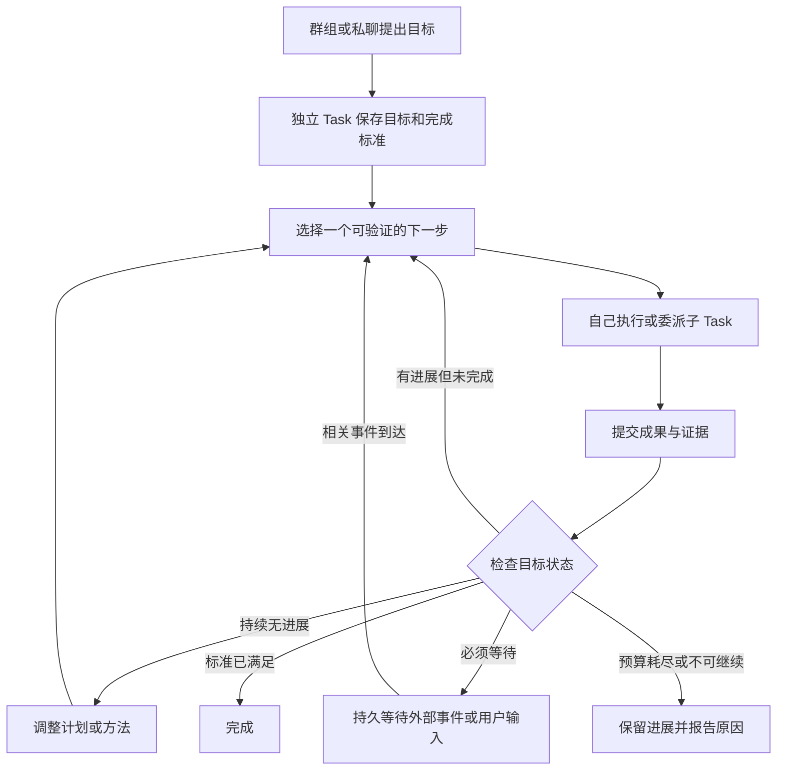

# 长任务持续推进：候选架构研究

调研：2026-11-01 至 2026-11-02（Asia/Shanghai）。状态：研究完成、实现未定。本记录不授权实施。

2026-11-02 承接说明：用户已要求确定分工、创建计划并分票；后续范围以[长任务持续执行计划](../../active/long-running-agent/README.md)为准。本文件保留研究过程，不再单独承担实施计划职责。

## 研究问题与判断

用户希望让 Pidot 在群组或其他入口持续推进通用复杂任务。当前已有 Task、上下文压缩和 pi-durable 恢复，主要缺口是目标未完成时的持续决策。

优先候选：为现有 Task 增加可选的目标推进循环，群组作为入口与协作展示。用同一个 Harness 执行协调、工作、验收和等待，不新增执行引擎。单机器人和群组共享这套机制，机器人数量按任务需要决定。

这个判断不等于已证明能稳定执行八小时。Task 与压缩能控制上下文规模，但不能保证模型不遗忘、不误判；pi-durable 能从已保存状态恢复，但进程/存储故障期间仍会停机，恢复后也需要业务规则确定下一步。

## 一手资料与可借鉴点

| 来源 | 对本问题有用的机制 | 适用限制 |
|---|---|---|
| [Microsoft Magentic-One](https://www.microsoft.com/en-us/research/articles/magentic-one-a-generalist-multi-agent-system-for-solving-complex-tasks/) | 任务台账、进展台账、停滞后的重规划 | 模型判断进展仍可能出错 |
| [Anthropic 长任务 Harness](https://www.anthropic.com/research/effective-harnesses-for-long-running-agents) | 明确要求、分步产出、交接与验证 | 主要是编码实验 |
| [Anthropic 后续设计](https://www.anthropic.com/research/harness-design-long-running-apps) | 执行与评估分离、阶段验收约定 | 额外评估有成本，不能假定模型评审总正确 |
| [OpenAI 长任务案例](https://developers.openai.com/blog/run-long-horizon-tasks-with-codex) | 持久目标、里程碑、验证与状态记录 | 单次长时间案例不证明通用成功率 |
| [Manus 上下文工程](https://manus.im/blog/Context-Engineering-for-AI-Agents-Lessons-from-Building-Manus) | 外部工作材料与及时刷新的目标/待办 | 笔记本身不能保证下一轮会启动 |

这是机制比较，不建议为此替换 pi-durable 或引入上述框架依赖。

## 候选方案

| 方案 | 优点 | 主要缺口 | 定位 |
|---|---|---|---|
| 提示词、计划工具、工作笔记 | 改动少，便于先验证模型行为 | 回复后仍可能停；完成和进展主要依赖模型自觉 | 对照基线，亦是其他方案的组成部分 |
| 群组轮流发言、互相提醒继续 | 用户能看见多人协作 | 可能讨论循环，责任和完成依据不清晰 | 不建议作为核心推进机制 |
| 持久目标状态 + 协调决策 + 执行/验证循环 | 支持动态规划、单人或多人、断点衔接 | 要定义提交、验证、停滞、等待和预算规则 | 优先候选 |
| 预定义工作流 | 稳定，步骤与检查易解释 | 对开放任务不灵活 | 适合成熟重复流程，作为执行步骤调用 |

## 目标推进循环

图中所有阶段都由原 Harness 执行和恢复。这是一套业务决策规则，不是额外的定时轮询器。

### 1. 一个目标有稳定身份

建议由现有的独立 Task 承载每个长期目标。群组关联目标和结果，多个目标各自持有状态。不要把整个群历史都当成一个目标的工作记忆。

目标台账记录目标、范围、完成标准及其修订，计划与依赖，已验证事实、待验证假设、成果引用、阻塞、下一步、累计用量。保存在同一 Harness Documents 中；群卡片与文件导出是投影。

目标和完成标准不能由执行者为了过关自行放宽。计划可以根据新证据调整；改变用户目标要保留来源与版本。恢复原目标不创建替代身份、不重置额度。

### 2. 明确一轮工作结束后的去向

当前 `tasks.mjs:finishReply()` 在无待处理协作/插入时清空输入并回到 `awaitInput`。候选修改应仅作用于用户启动的持续任务：一轮回复只算阶段提交，之后进入目标状态判断；普通聊天保持现有行为。

每轮决定应回答：新产出是什么、支持哪些完成标准、还缺什么、下一步是什么、为什么值得做。可选动作包括继续、委派、验证、重规划、等待、完成或报告无法继续。

程序负责检查决定是否符合当前状态、预算、权限和版本。模型负责提出计划与语义判断。程序能验证证据存在和绑定正确，但不能凭结构化 JSON 就保证内容真实。

### 3. 验收依据随任务变化

| 任务类型 | 有效进展举例 | 完成依据举例 |
|---|---|---|
| 调研分析 | 新增可信来源、解决一个矛盾、填补一个子问题 | 必答问题覆盖、关键结论有出处、反例与不确定性已处理 |
| 文档和创作 | 成稿新增满足要求的部分、具体评审问题被修复 | 必需内容、格式、事实与约定质量标准满足 |
| 业务操作 | 获得可核对的操作回执 | 请求目标状态已确认，未知结果未被当作成功 |
| 代码任务 | 行为实现、真实失败被修复 | 对应行为检查与运行结果通过 |

执行者提交证据，协调者检查；关键里程碑可以增加独立评审。评审也是模型时仍存在误判，需要任务适用的外部检查支持。无需为每一个工具调用配置多个机器人。

### 4. 停滞、等待和结束各有规则

- 对比成果版本、证据变化、重复动作和失败原因，不能只依赖模型自报“有进展”。
- 持续无进展时改变方法、缩小当前步骤或重新分工；重规划也有界限，耗尽后如实报告未完成。
- 等待子任务、必要问题或外部结果时使用持久等待；相关事件到达才恢复。
- 某分支阻塞时，可继续没有依赖的其他分支；必要阻塞未解决时不能整体完成。
- 临时模型错误可以设计有限重试；未知写入结果沿用现有核查规则，不能重放来制造进展。
- 完成、失败、等待、用户暂停、取消、额度受限必须分开。八小时是允许工作的时间范围，不是必须填满的运行时长。

### 5. 上下文与预算贯穿目标全程

每轮优先读目标、当前阶段、剩余标准、相关证据与失败记录。详细材料按引用回查；执行者只拿当前步骤需要的上下文，协调者不重复吸收全部工具输出。现有来源可见性和授权检查继续适用。

根目标累计协调、执行、评估、压缩与所有子 Task 的用量，避免通过新输入或新子任务重置预算。新子任务仅用于新的有界工作或独立角色；失败和返工继续原来的子 Task。

## 在群组中的体验

用户在群里启动一个目标，管理员成为本目标的协调者。界面展示目标卡、当前阶段、已验收成果、阻塞与用量；群消息用于里程碑更新和用户调整。执行细节留在相关 Task，降低群聊噪声。

同样的目标也可从私聊启动，仍由当前机器人协调，在需要时委派。协调者是本目标的职责，不要求所有目标都由 pipi 接管，也不改变普通机器人平等的设定。

## 与现有代码的衔接

- `server/groups.mjs:46–64`：群组本身已由管理员 Task 支撑，适合作为目标入口。
- `server/collaboration.mjs:145–199`：已具备结果收集、精确修订验收和原子任务返工，可作为阶段提交链路。
- `server/tasks.mjs:138–182`：回复结束的语义是最直接的衔接点；需区分普通输入与持续目标。
- `server/task-context.mjs`、`context-compaction.mjs`：读取目标投影与按需回查，保留当前压缩体系。
- 本地 `pi-durable` 1.3.0 的 Task、Document、commit、waiting/resume 支撑状态存储与恢复。现有 Pidot 自定义执行循环并不自动获得库内所有生成策略，需逐项确认集成。

## 如何验证候选是否值得实现

先准备固定的通用任务样本和验收依据，用相同模型比较当前实现、提示词/笔记增强、目标循环三种方式。先验证提前回复后会继续、完成后能停、阻塞时能等待，再逐步拉长到一小时、四小时和八小时。

覆盖过程：模型临时失败、重启、上下文压缩、子结果重复到达、用户修改目标、停滞重规划、预算耗尽与未知写入。

记录完成标准达成率、错误完成率、有效成果、重复执行次数、人工介入次数、恢复后是否保持原目标，以及总用量和耗时。不得把等待或重复调用累积的时间算成成功。

## 尚未确定的实现选择

1. 首版先支持单执行者，还是直接接入群组委派；建议先验证同一个目标循环，再接群组展示。
2. 哪些阶段必须独立评审，哪些可以用确定性检查或协调者核查。
3. 目标台账的具体 Document 字段和 Task 阶段衔接；属于后续设计，不在本次研究中定稿。

## 项目改造范围（2026-11-02 补充，仍为候选）

本节回应“实现功能需要怎样改造项目”，不代表已经开始实现。建议采用增量扩展，保留现有单进程、单 SQLite、单 Harness。

### 数据和执行

- 复用 `TaskCard.taskState.goal/completionCriteria/constraints`，它们已经在 `task-creation.mjs` 初始化，并被 `task-context.mjs` 注入。不要再建立另一份目标真源。
- 在现有任务创建契约增加明确的持续执行选项，旧 Task 缺省沿用聊天行为。模型配置里的 `mode` 已表示 model/test，不能用它表示持续任务。
- 新增 Task 范围的进度 Document，保存阶段、依赖、当前步骤、成果与证据引用、计划修订、停滞记录和控制信息。目标修订和进度引用须能对应；阶段状态不复制 Harness 的调度状态。
- 给 `chatDefinition()` 增加目标决策、阶段验证和必要的持久等待衔接。名字未定，必须由原 Harness 调度。
- `finishReply()` 要区分中间进展与整个工作结束。中间进展不能清空原请求、停用其 Skill、发布最终子任务结果或把主会话派生任务标为成功。
- 不通过不断伪造新的用户输入实现续跑。保留原根任务/工作身份、累计额度、等待和审批绑定，内部阶段推进写持久事件。
- 规划、执行和验收使用明确提示与结构化提交。宿主校验版本、证据绑定和允许的状态转换；语义质量仍需要模型和具体任务检查。

### 群组关联与协作

当前 `collaboration.mjs:execute()` 明确禁止协作子任务继续委派，现有群关系的核验也要求父 Task 本身是该群 Task。因此“群 Task → 协作子任务形式的目标 → 执行者”不能直接复用。

优先方案：群组只关联一个独立的目标协调 Task，由目标 Task 委派一层执行者。群入口关系和执行父子关系分别建模，保留现有禁止执行者再次委派的规则。

要调整的契约包括：群来源消息与成员范围、协调者身份、根工作身份、结果回交地址、群归档/删除与目标取消的关系。当前来源授权检查必须仍然成立，不能单纯改 `kind` 或移除深度限制。

既有 `task_assign/task_review` 和结果收集可复用；阶段结果需要绑定阶段及目标修订。用户调整目标后，旧结果可以保留为证据，但不能未经重验直接满足新的完成标准。原有直接 @ 派发的语义须保持兼容。

### 上下文、恢复和额度

- 每轮注入目标、当前阶段、未满足标准、有关证据与最近失败；详细资料继续通过现有引用工具回查，保持来源权限检查。
- 新进度 Document 要接入归档、取消、恢复投影和必要的上下文快照路径；仅增加状态文件不足以支持生命周期。
- 临时模型异常增加有界重试，持久保存次数和下次可重试时间；恢复时再次检查停止、权限和额度。非临时错误转为明确失败/阻塞。
- 根目标额度覆盖协调、执行、验证、压缩和子任务，派发前在事务中检查和预留。并发子任务不能同时透支同一余额；恢复、重复回执不得重复记账。
- 暂停应在安全边界生效，已发出的操作继续保存真实回执；暂停、取消、额度受限及等待原因须区分，恢复不能复活已取消目标。

### 接口和界面

- 扩展任务查询，返回目标进度、阶段成果、阻塞、总用量和可用操作；新增持续任务启动及暂停/恢复/调整目标的明确接口或动作。变更请求需要稳定 requestId 和版本校验。
- 群组和私聊复用一张目标卡；扩展现有 `GroupTaskBoard`、`CollaborationOverview`、`TaskTimeline` 等展示。
- 展示当前阶段、执行者、可验证成果、等待原因及额度，提供调整/暂停/继续/停止。不要用运行秒数或未经核实的百分比代表完成度。
- 里程碑与需要处理的事项进入群消息，详细工具输出保留在 Task。

### 建议交付顺序与验证

1. 独立 Task 的目标状态与推进闭环：单执行者即可验证自动续跑、阶段提交、验收、完成和有限预算；同时添加恢复与普通聊天兼容回归。
2. 群组/私聊入口与协作：独立目标关联、单层委派、结果验收、全目标额度和 UI；验证群内其他消息不会错改活动目标。
3. 长时可靠性与效果验证：停滞重规划、临时故障、压缩、重启、重复事件、暂停/取消/撤权；在行为测试通过后逐步进行真实一小时、四小时、八小时任务评估。

代码改动须运行项目 test、lint、build，并做群组/私聊界面检查。新字段以兼容方式引入，旧任务不自动转为持续任务。本次没有执行这些实现或测试。
