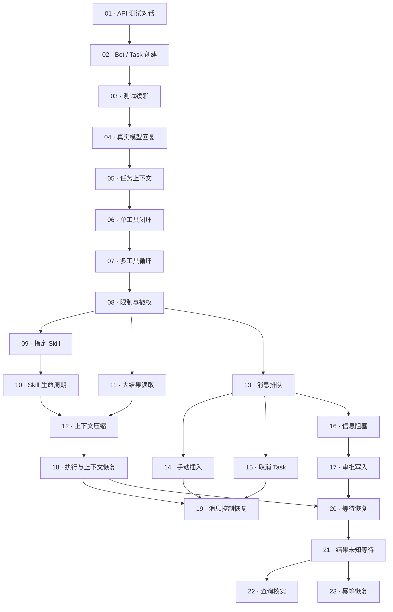

> **归档说明**：本文是计划当时的原文，未改写。文中 `issues/`、`progress/`、`evidence/` 等相对链接指向原始实施目录，原始票据、日志与验收证据保留在本地 `.scratch/`，不随本仓库分发；已归档到仓库外的备份仓库 `~/code/pidot-history-backup-20261025.git`（用 `git --git-dir=<备份> show HEAD:<路径>` 可取回）。

# Agent 初始骨架与基础 loop — 任务索引

> **已完成并归档（2026-10-17）**：23/23 issue、135/135单票、11/11联合验收；终验368/368，lint/build通过。见[正式归档入口](../../docs/archive/agent-loop-foundation-2026-10-17/README.md)与[下一阶段交接](../../../../NEXT_STAGE.md)。本文旧阶段日志仅作历史，不再是活动待办。

更新日期：2026-10-17（Asia/Shanghai）。本目录发布用户逐阶段确认的 23 张独立任务票，按 to-tickets 的本地文件格式保存。项目未发现已配置的外部任务跟踪器，当前采用本地文件作为本轮任务清单。

## 里程碑目标

从本地 API 测试对话逐步到网页中的真实模型、多轮工具执行、活动 Skill 与上下文管理、消息控制、用户确认，以及服务重启和外部动作结果未知时的正确恢复。

本轮是完整 MVP 之前的运行骨架里程碑。预置 Bot 可以作为任务入口；Chief 管理、群聊和多 Bot 协作、真实日历/邮件/待办集成、定时任务与推送进入后续里程碑。支付工具保持后续特殊扩展，MVP 不接支付。

## 现有工程与选用边界

- 现场已有前端工程，首张票利用现有工程搭建本地服务与 API。已有工程不等于这些票的验收已完成。
- Harness 已按用户确认引入 `@earendil-works/pi-durable@1.3.0` 及同版本配套包（MIT），记录见 [02 选用确认](issues/02-harness-selection.md)。compaction已按用户确认复用1.3.0与Task薄适配（issue12 completed）；Skill生命周期见#9/#10，工具搜索仍保留复用候选身份。新选用的具体版本、许可证、拟使用能力与适配范围仍须确认；任务拆解获批不等于依赖获批。
- 第一轮工具按登记的授权集合展示；动态搜索和发现按后续需要接入。
- Bot 提供身份与配置；Harness Task id 为执行关联标识，conversation 属于 Task，任务卡、配置引用、Skill 活动记录及调用计数放关联 Document，不另建任务状态表。
- 任务计数、限制默认值及允许的恢复操作需在对应票实施时明确，采用简单每 Task 限制。中断时未知用量保留未知，不宣称费用阈值精确封顶。
- 配置在 Task 内固定，用户撤权对旧 Task 后续调用生效。执行间显式迁移、完整配置管理界面和自动记忆维护属于后续交付，当前架构决定继续有效。
- 本轮使用模拟日历和测试数据；真实模型凭证留在服务端。不得把凭证写入票据、产物或对话。

## 执行规则

每张票单独包含交付行为、明确阻塞边和验收清单。ready-for-agent 表示票据已整理为可交接任务，并不表示阻塞已完成或功能已实现。

只推进前置票均已完成的任务；有选用评审等实施前置时同样满足后再引入依赖。**01（1A-1）已于 2026-10-16 完成并通过验收**，记录见 [01 验收记录](issues/01-acceptance.md)。**02（1A-2）也已于 2026-10-16 完成**，见 [02 验收记录](issues/02-acceptance.md)。**03、04 已完成**，见对应验收记录。**05已在本轮完成格式兼容与严格真实网页/正常重启补验**，旧失败保留于[05记录](issues/05-acceptance.md)。**06已完成**只读模拟日程基础工具闭环，见[06验收](issues/06-acceptance.md)。**07已完成**模拟事件详情、多轮依赖前序回执、顺序关联展示、错误回填和调用限制；96项自动测试、lint/build、真实模型及桌面/移动网页验证通过，见[07验收](issues/07-acceptance.md)。**08已完成**简单累计限额、显式提额续跑、即时撤权网页入口；103项测试及真实模型/网页验收通过，见[08验收](issues/08-acceptance.md)。**13已完成**普通消息持久化 FIFO、逐条状态与刷新回读；受限只排队、提额先续原输入，见[13验收](issues/13-acceptance.md)。**14已完成**显式插入、安全边界、队列转插入、真实回执保留与权限/限额保护，见[14验收](issues/14-acceptance.md)。未将后续票标完成。没有创建外部 issue。

编号保留讨论阶段映射。依赖来自已确认拆分，仅记录真正的开工前置，阶段编号不构成整阶段串行要求。例如第 3、第 4 阶段均从 08 后展开；22、23 也不相互依赖。

## 任务列表

| 编号 | 讨论编号 | 任务 | Blocked by |
|---|---|---|---|
| 01 | 1A-1 | [环境搭建到 API 返回对话](issues/01-conversation-api.md)（已完成） | 无 |
| 02 | 1A-2 | [选择 Bot，创建并查看 Task](issues/02-bot-task-creation.md)（已完成） | 01 |
| 03 | 1A-3 | [完整测试对话与重开续聊](issues/03-persistent-test-chat.md)（已完成） | 02 |
| 04 | 1B-1 | [在已有 Task 中获得真实模型回复](issues/04-real-model-response.md)（已完成） | 03 |
| 05 | 1B-2 | [让真实模型按任务配置持续对话](issues/05-task-context-conversation.md)（已完成） | 04 |
| 06 | 2-1 | [模型调用一个工具，并根据结果回复](issues/06-single-tool-cycle.md)（已完成） | 05 |
| 07 | 2-2 | [连续调用不同工具，完成一项任务](issues/07-multi-tool-loop.md)（已完成） | 06 |
| 08 | 2-3 | [调用受限或权限撤销时，正确停下并保留进度](issues/08-limits-and-revocation.md)（已完成） | 07 |
| 09 | 3-1 | [用户指定 Skill，Bot 加载后按规则完成任务](issues/09-explicit-skill-activation.md)（已完成） | 08 |
| 10 | 3-2 | [Bot 按任务选择 Skill，并在阶段结束后停用](issues/10-skill-lifecycle.md)（已完成） | 09 |
| 11 | 3-3 | [工具返回大量资料时，Bot 按需读取并完成任务](issues/11-bounded-tool-results.md)（已完成） | 08 |
| 12 | 3-4 | [上下文压缩后，继续遵守任务目标和活动 Skill](issues/12-context-compaction.md)（已完成） | 10、11 |
| 13 | 4-1 | [Bot 忙碌时，普通消息排队并按顺序消费](issues/13-queued-messages.md)（已完成） | 08 |
| 14 | 4-2 | [用户明确插入消息，让当前工作在安全边界采用新要求](issues/14-explicit-steer.md)（已完成） | 13 |
| 15 | 4-3 | [取消指定 Task，停止后续执行并保留记录](issues/15-task-cancellation.md)（已完成） | 13 |
| 16 | 5-1 | [缺少必要信息时，向用户提问并恢复原任务](issues/16-question-blocker.md)（已完成） | 13 |
| 17 | 5-2 | [模拟日历修改经用户批准后执行，拒绝后调整方案](issues/17-approved-calendar-write.md)（已完成） | 16 |
| 18 | 6-1 | [恢复执行进度、配置和上下文](issues/18-execution-context-recovery.md)（已完成） | 12 |
| 19 | 6-2 | [恢复消息队列、手动插入和取消结果](issues/19-message-control-recovery.md)（已完成） | 18、14、15 |
| 20 | 6-3 | [恢复等待事项，用户处理后继续执行](issues/20-waiting-recovery.md)（已完成） | 18、17 |
| 21 | 7-1 | [结果无法确认时，保留现场并等待用户核实](issues/21-unknown-action-outcome.md)（已完成） | 20 |
| 22 | 7-2 | [工具支持可靠查询时，自动核实并补录结果](issues/22-query-action-outcome.md)（已完成） | 21 |
| 23 | 7-3 | [工具支持稳定幂等键时，安全恢复原操作](issues/23-idempotent-action-recovery.md)（已完成） | 21 |

## 依赖总览

## 检查点

| 检查点 | 完成条件 | 可演示结果 |
|---|---|---|
| API 入口 | 01 | 经过认证的消息请求返回明确标记的测试回复 |
| 持久化测试会话 | 01—03 | 网页创建会话，保存测试对话，正常重启后续聊 |
| 真实模型多轮对话 | 01—05 | 模型使用固定配置与同 Task 历史持续交流 |
| 基础工具 loop | 01—08 | 多轮工具执行、回执回填、调用受限与即时撤权 |
| 可恢复运行骨架 | 全部 23 票及下方联合验收 | 上下文、消息、审批及结果未知处理协同工作 |

## 整体联合验收

联合验收在涉及的分支均完成后执行，不新增独立票或抬高早期票的开工依赖。

2026-10-17 逐项复测证据与范围见 [联合验收记录](../../../../.planning/joint-acceptance/acceptance.md)。仅在相应证据核对后更新勾选。

- [x] 在网页选择预置 Bot，创建 Task，使用真实模型分析模拟日程；至少一次工具调用依赖前一调用结果。
- [x] 在指定或按需选择 Skill 的工作中读取大结果并压缩，继续遵守已生效的目标和限制，保留调用与回执关联。
- [x] 普通消息排队且消费前不影响当前工作；明确插入在安全边界生效，同一输入不重复消费。
- [x] 审批等待与队列并存时，普通消息不默认批准或解除等待（13、17）。
- [x] 手动插入改变待执行操作时，旧批准不能套用到新参数（14、17）；需要新的精确确认。
- [x] 执行中、预算等待和审批等待均可取消；迟到结果、旧审批和重启不使 Task 复活（15、17、19、20）。
- [x] 用户撤权在旧 Task、审批后执行和恢复重试前均生效；调用计数跨重启保留，提高限制必须显式进行。
- [x] 分别在已保存执行检查点、消息排队、Skill 活动和审批等待时中断，重启后恢复原 Task、配置、历史、计数与等待条件。
- [x] 制造模拟写入完成但回执未保存的中断：缺少可靠核实能力时等待用户，可靠查询时补录结果，稳定幂等能力有效时复用原标识取得结果。
- [x] 幂等恢复与查询能力同时就绪时，保障失效按工具支持进入查询或等待；已取消或撤权时不再重试写入（15、22、23）。
- [x] 全程只产生符合工具保障的业务效果，结果未知不伪装成失败或成功；模拟写入验证不依赖付款工具。

## 关联架构

- [产品与系统架构](../../CONTEXT.md)
- [Agent 运行架构](../../docs/agent-runtime-proposal.md)
- [项目协作约定](../../CLAUDE.md)

本索引记录本轮已批准范围和执行依赖，不替代完整架构。完成本里程碑后，再拆 Chief 管理、多 Bot 协作、显式配置迁移和真实业务集成。

## iss16 已完成（2026-10-17）

信息阻塞提问/认证用户定向回答与原Task恢复已完成，专项15/15、全量212/212、lint/build、真实供应商及桌面/移动网页验证通过，详见 [16验收记录](issues/16-acceptance.md)。#17及后续恢复票未标完成。

### iss17 完成（2026-10-17）
精确模拟改期审批、认证批准/拒绝、执行复查/单次回执、网页追溯完成；专项24/24，全量236/236，lint/build及真实模型/1440桌面/390移动通过。见[17验收](issues/17-acceptance.md)。#18–23恢复票仍保留原状态。

### iss19 完成（2026-10-17）
原Task FIFO/消费/插入/取消硬重启恢复与网页追溯完成；13专项、全量263/263、lint/build、真实模型及1440/390验证通过。见[19验收](issues/19-acceptance.md)。#20–23及联合验收保持原状态。

### 21 已完成（2026-10-17）
沿用原Harness Task/awaitApproval及TaskApprovals。精确批准复查后，先提交随机operationId、原参数/事件、批准绑定与调用用量，再独立提交模拟日历副作用，最后保存执行回执。恢复遇有意图无回执进入`action-outcome-unknown`，不猜测成功/失败、不自动重做或清零；派发前未动作即退出也保守等待。此段为iss21历史阶段；可靠查询/稳定幂等现由#22/#23完成。

认证`POST /api/tasks/:taskId/approvals/:approvalId/verify`仅接受`outcome=completed|unknown|retry`和必填note。仍未知保持原等待；完成以`authenticated-user-verification`来源记账、`independentlyVerified=false`，不伪造工具查证、事件或重复修改，按原输入后FIFO继续。重新操作只创建同参数的新精确审批，保留原未知现场；须显式`acknowledgeDuplicateRisk=true`再批准，当前权限/资源/调用限额/事件冲突/取消继续检查。取消不回滚外部效果，迟到真实回执只保留、不复活。

16项专项含真实独立进程SIGKILL（意图前后/动作后丢回执/核实和重批已提交/回执/取消），299/299全量、lint/build通过。真实bb-api/deepseek-v4.1-flash原Task#7/审批#33：写入后强杀，恢复静默500ms，仍未知再200ms零调用，用户核实后无写重放；4模型/4工具/11787Token、未知0，revision=1。1440桌面/390移动核实、刷新、重复风险重批、取消通过，scrollWidth390、控制台0错误0警告；UI是独立确定性适配器，不冒充供应商证据。验收见`.scratch/agent-loop-foundation/issues/21-acceptance.md`。无新依赖/.env/正式DB改动，无Git初始化或提交。

## iss22 验收完成（2026-10-17）
原操作可靠查询与来源恢复回执、有限只读核实和未知等待已完成；25项专项、324项全量、lint/build、真实模型故障恢复及桌面/移动网页验证通过。见[22验收](issues/22-acceptance.md)。当时尚未完成的#23现已验收，见下节。

## iss23：稳定幂等标识安全恢复（2026-10-17）

模拟改期工具新操作明确声明稳定幂等契约：原operationId、精确批准参数与原意图绑定，保障从意图时间起24小时（左闭右开）。工具独立效果事务同存请求哈希/原结果/效果；同键不同请求拒绝，同键相同请求在窗口内返回原结果，不覆盖后来编辑过的会议。恢复复用原Harness Task/awaitApproval、审批和标识，最多3次、每次2秒，先持久attempt及工具用量；每次和实际派发时复核权限、资源、预算、取消及原审计。过期/条件不成立不执行无保障重试，走iss22可靠查询或iss21未知等待。旧能力快照不升级。

恢复回执来源`tool-idempotent-recovery`、independentlyVerified=true，附原请求哈希/窗口/原结果和replayed；replayed=true表示取回原结果、无第二次业务修改。网页与模型上下文区分幂等恢复、只读查询、用户核实。迟到回执不复活取消Task；普通消息不授权或重启尝试。35项专项及359/359全量、lint/build通过；真实模型Task7/审批33写后强杀，恢复原键再次派发返回原结果，2次工具派发/0查询/1业务修改，revision1；4模型/5工具/15502Token、未知0。1440桌面/390移动通过，无溢出、控制台0错误0警告。

仅模拟同SQLite内分事务外部边界，**不由Harness持久化推断真实外部exactly-once**。无新依赖、表或状态机，不改.env/正式数据库，无Git初始化或提交。issue23的7条验收完成，详见`.scratch/agent-loop-foundation/issues/23-acceptance.md`；不将全部票据的联合里程碑验收自动视为完成。

